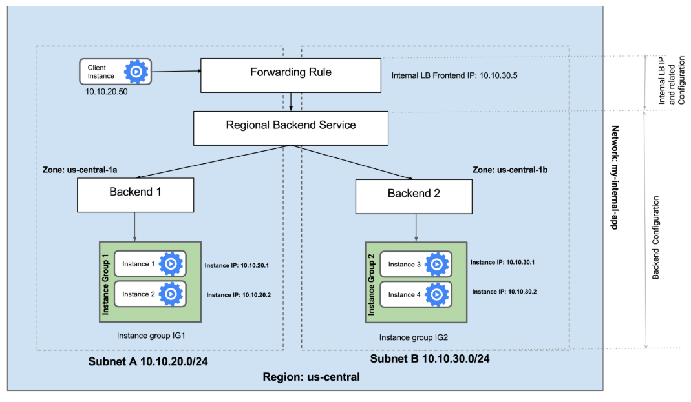
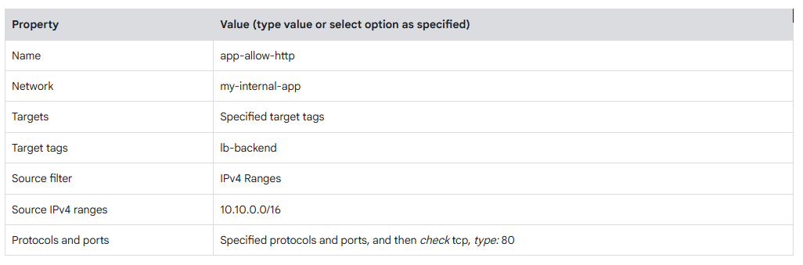
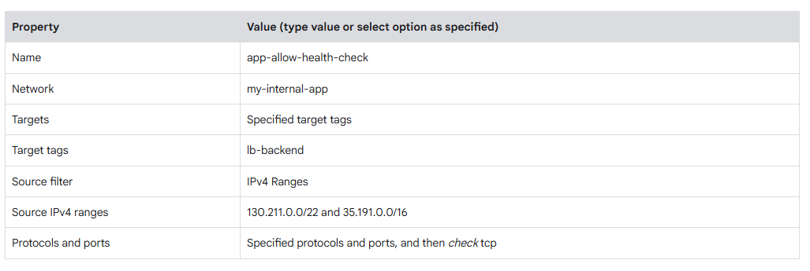
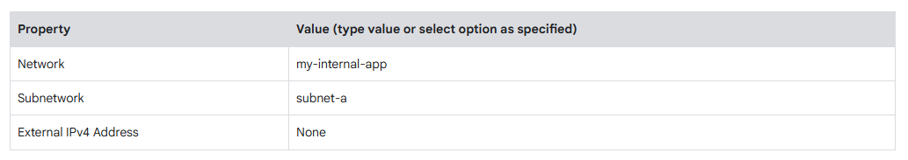

# TECHNICAL LOG & Creating an Internal TCP/UDP Load Balancer in Google Cloud

## Creating an Internal TCP/UDP Load Balancer in Google Cloud GSP216
**CCNP Miguelangel Luna**

---

An Internal TCP/UDP Load Balancer enables you to run and scale your services behind a private internal IP address that is accessible only to instances within the same VPC network, peered networks, or connected hybrid environments (via Cloud VPN or Interconnect).

---
### Architecture Overview

An internal load balancer consists of the following primary components:
1. **Health Check:** Monitors the availability and responsiveness of your backend virtual machine (VM) instances.
2. **Backend Service:** Defines how the load balancer distributes traffic to backend instances (based on region, protocol, and session affinity).
3. **Backend Instances:** Managed Instance Groups (MIGs) or unmanaged instance pools that process the traffic.
4. **Forwarding Rule:** Assigns a private internal IP address and port scope to receive incoming traffic and route it to the backend service.

---

### Step-by-Step Configuration Guide

#### Step 1: Create a Health Check
A health check probes your backend instances to ensure they are ready to receive traffic.

```bash
```


## CONTENT:

| Case | Title | Description |
| :--- | :--- | :--- |
| **01** | [Claude & n8n AI Agents](./case-01-Google-Auth/) | Agentes Claude . |

[Google](https://www.google.com)

## 1. Introduction and Theoretical Framework

## Overview: Google Cloud Internal Load Balancing (ILB)

Google Cloud's Internal Load Balancing (ILB) is a crucial service for managing and scaling your private application infrastructure. It enables you to distribute TCP/UDP-based traffic efficiently across internal virtual machine instances, ensuring your applications are highly available and performant within your private network. By providing a single, stable private IP address for your services, ILB simplifies internal application communication and enhances system resilience.

In this lab, you will set up an internal service by creating two managed instance groups in the same region, representing a common deployment pattern for highly available applications. Next, you will configure and thoroughly test an Internal Load Balancer, using these instance groups as its backends. This setup mimics a real-world scenario where an internal application—such as a microservice, an API endpoint, or a database—needs to be accessible to other internal services or applications without exposure to the public internet.


## 2. Topology and BGP Neighbor Establishment




## Configuration:

## Task 1: Configure HTTP and Health Check Firewall Rules

Proper firewall rules form the foundation of a secure and functional internal load-balanced environment. They ensure that only authorized traffic reaches your backend services and that the load balancer can accurately assess the health of your instances.

You will configure firewall rules to allow HTTP traffic to the backends as well as TCP traffic from the Google Cloud health checker.

---

### Explore the `my-internal-app` Network

The `my-internal-app` network—complete with `subnet-a`, `subnet-b`, and pre-configured firewall rules for RDP, SSH, and ICMP traffic—has already been set up for you.

1. In the Google Cloud Console, navigate to **Navigation menu > VPC network > VPC networks**.
2. Scroll down and verify the `my-internal-app` network and its associated subnets (`subnet-a` and `subnet-b`).
3. While every Google Cloud project starts with a default network, `my-internal-app` has been pre-provisioned as part of your lab architecture diagram.
4. You will create your managed instance groups in `subnet-a` and `subnet-b`. Because an Internal Load Balancer is a regional service, both subnets must reside in the same region (`REGION`). Placing the managed instance groups in different zones ensures your service remains resilient against zonal outages.

---

### Create the HTTP Firewall Rule

Create an ingress firewall rule to allow HTTP traffic to your backend instances both from the load balancer and from the internet (which is required to install the Apache web server on your backend VMs).

1. In the **VPC networks** section, click **Firewall** in the left navigation pane.
2. Review the pre-created `app-allow-icmp` and `app-allow-ssh-rdp` firewall rules.
3. Click **+ Create Firewall Rule**.
4. Configure the following parameter values, leaving all other fields at their defaults:



   > **Note:** Ensure you include `/16` in the **Source IPv4 ranges** field to specify all targeted networks.

5. Click **Create**.

### Create the Health Check Firewall Rules

Health checks determine which instances behind a load balancer can receive new traffic. For Google Cloud Internal TCP/UDP Load Balancing, health check probes originate from specific IP address ranges: `130.211.0.0/22` and `35.191.0.0/16`. Your firewall rules must allow ingress traffic from these sources.

1. Remaining on the **Firewall** page, click **+ Create Firewall Rule**.
2. Configure the following parameter values, leaving all other settings at their defaults:



> **Note:** Ensure you enter the two source IPv4 ranges one by one, pressing **Space** or **Enter** after each range to add them correctly in the console.

3. Click **Create**.

## Task 2: Configure Instance Templates and Create Instance Groups

Instance templates and managed instance groups (MIGs) are the backbone of scalable, resilient, and manageable cloud applications. They enable you to define a standardized configuration for your virtual machines and automatically manage their lifecycle, ensuring operational consistency while supporting automated scaling and self-healing.

A managed instance group uses an instance template to deploy and manage a group of identical VM instances. You will use these groups to configure the backend infrastructure for the Internal Load Balancer.


## Configure the Instance Templates

An instance template is an API resource you can use to create VM instances and managed instance groups (MIGs). Instance templates define the machine type, boot disk image, subnet, network tags, and other instance properties. You will create an instance template to be used across the subnets of the `my-internal-app` network.

1. In the Google Cloud Console, navigate to **Navigation menu > Compute Engine > Instance templates**.
2. Click **Create instance template**.
3. For **Name**, type `instance-template-1`.
4. For **Location**, select **Global**.
5. For **Series**, select **E2**.
6. For **Machine type**, select **Shared-core > e2-micro**.
7. Click **Advanced options**.
8. Click **Networking**.
9. For **Network tags**, specify `lb-backend`.

> **Note:** The network tag `lb-backend` ensures that your previously created HTTP and health check firewall rules apply correctly to these backend instances.

10. For **Network interfaces**, click the dropdown icon to edit the interface settings.
11. Configure the following values, leaving all other fields at their defaults:



1. Click **Done**.
2. Click **Management**.
3. In the **Automation > Startup script** field, paste the following script:

```text
#!/bin/bash
apt-get update
apt-get install -y apache2 php libapache2-mod-php
cat <<'EOF' > /var/www/html/index.php
<h1>Internal Load Balancing Lab</h1>
<h2>Client IP</h2>
Your IP address : <?php echo $_SERVER['REMOTE_ADDR']; ?>
<h2>Hostname</h2>
Server Hostname: <?php echo gethostname(); ?>
<h2>Server Location</h2>
Region and Zone: <?php
  $ch = curl_init();
  curl_setopt($ch, CURLOPT_URL, "http://metadata.google.internal/computeMetadata/v1/instance/zone");
  curl_setopt($ch, CURLOPT_HTTPHEADER, array('Metadata-Flavor: Google'));
  curl_setopt($ch, CURLOPT_RETURNTRANSFER, 1);
  $zone = curl_exec($ch);
  $parts = explode('/', $zone);
  echo end($parts);
?>
EOF
rm -f /var/www/html/index.html
systemctl restart apache2
```

---

### Create the Health Check Firewall Rules

Health checks determine which backend instances of a load balancer can receive new connections. For Internal TCP/UDP Load Balancing, health check probes originate from Google Cloud's designated IP ranges: `130.211.0.0/22` and `35.191.0.0/16`. Your firewall rules must explicitly allow incoming connections from these address ranges.

1. Remaining on the **Firewall** page, click **+ Create Firewall Rule**.
2. Configure the following parameter values, leaving all other fields at their defaults:


Note: Make sure to enter the two Source IPv4 ranges one-by-one and pressing SPACE in between them.
Click Create.
Click Check my progress to verify the objective.

**R:**


```

### Configuration:


