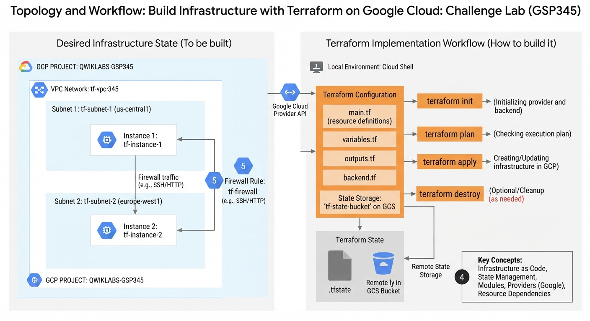

# TECHNICAL LOG & AUTOMATION ENGINEERING GUIDE

## TERRAFORM ON GCP (GSP345)
**CCNP Miguelangel Luna**

---

## CONTENIDOS:

| Case | Title | Description |
| :--- | :--- | :--- |
| **01** | [Claude & n8n AI Agents](./case-01-Google-Auth/) | Agentes Claude . |

[Google](https://www.google.com)

## 1. Introduction and Theoretical Framework


El objetivo **(GSP345)** es crear una infraestructura en Google Cloud (una red VPC, subredes, instancias de VM y reglas de firewall) utilizando Terraform, siguiendo el flujo de trabajo de CI/CD con GitHub Actions.

**Estructura de carpetas:**

```text
.
├── main.tf
├── variables.tf
└── modules/
    ├── instances/
    │   ├── instances.tf
    │   ├── outputs.tf
    │   └── variables.tf
    └── storage/
        ├── storage.tf
        ├── outputs.tf
        └── variables.tf
```


Estructura de archivos:

**Archivo main.tf:**  Archivo de configuración principal de un proyecto Terraform, define la infraestructura que deseas crear, modificar o gestionar, ya sea declarando los recursos directamente o llamando a módulos que los contengan. Es el plano principal de tu infraestructura: es el lugar donde se describe, de forma legible, qué quieres construir en la nube.

**Ejemplo:**

```text
provider "google" {
  project = var.project_id
  region  = var.region
}

# 1. VPC Network
resource "google_compute_network" "vpc_network" {
  name                    = "tf-vpc-345"
  auto_create_subnetworks = false
}

# 2. Subnets
resource "google_compute_subnetwork" "subnet_1" {
  name          = "tf-subnet-1"
  ip_cidr_range = "10.0.1.0/24"
  region        = "us-central1"
  network       = google_compute_network.vpc_network.id
}

resource "google_compute_subnetwork" "subnet_2" {
  name          = "tf-subnet-2"
  ip_cidr_range = "10.0.2.0/24"
  region        = "europe-west1" # Región diferente para la segunda instancia
  network       = google_compute_network.vpc_network.id
}

# 3. Firewall Rule
resource "google_compute_firewall" "firewall_rule" {
  name    = "tf-firewall"
  network = google_compute_network.vpc_network.name

  allow {
    protocol = "tcp"
    ports    = ["22", "80"] # Permitir SSH (22) y HTTP (80)
  }

  source_ranges = ["0.0.0.0/0"] # Permite tráfico desde cualquier lugar (inseguro para producción, pero aceptable en labs)
}

# 4. Instances
resource "google_compute_instance" "instance_1" {
  name         = "tf-instance-1"
  machine_type = "e2-medium"
  zone         = "us-central1-a"
  tags         = ["web"] # Tag para aplicar la regla de firewall

  boot_disk {
    initialize_params {
      image = "debian-cloud/debian-11"
    }
  }

  network_interface {
    subnetwork = google_compute_subnetwork.subnet_1.name
    # Sin acceso a IP externa explícito; por defecto se asigna una efímera en GCP
  }
}

resource "google_compute_instance" "instance_2" {
  name         = "tf-instance-2"
  machine_type = "e2-medium"
  zone         = "europe-west1-b"
  tags         = ["web"] # Tag para aplicar la regla de firewall

  boot_disk {
    initialize_params {
      image = "debian-cloud/debian-11"
    }
  }

  network_interface {
    subnetwork = google_compute_subnetwork.subnet_2.name
    # Sin acceso a IP externa explícito; por defecto se asigna una efímera en GCP
  }
}
```
--------------------------------------------------------------------------------------

**Archivo variables.tf:**  Define los parámetros de entrada (valores que pueden cambiar)

```text
variable "project_id" {
  description = "The ID of the project where resources will be created"
  type        = string
}

variable "region" {
  description = "The region for the resources"
  type        = string
  default     = "us-central1" # Cambia esto si el lab pide otra
}
```

--------------------------------------------------------------------------------------

**Archivo backend.tf:**   (Configuración para guardar el estado de Terraform de forma remota en un Bucket de GCS).

```text
terraform {
  backend "gcs" {
    bucket  = "TU-BUCKET" # ELIMINAR: Sustituir por el nombre real del bucket creado
    prefix  = "terraform/state"
  }
}
```

--------------------------------------------------------------------------------------

Primero, debes crear un Bucket en GCP para esto, por ejemplo: tf-state-bucket-gsp345-xyz. Sustituye TU-BUCKET por el nombre real.


Paso 3: Crear la Cuenta de Servicio de GCP para GitHub Actions
GitHub Actions necesitará permisos para ejecutar Terraform en tu proyecto.


**Topologia:**


1. **Modular Structure:** Separation of concerns using root configuration (`main.tf`, `variables.tf`) and reusable local modules (`modules/instances`, `modules/storage`).
2. **Resource Import:** Importing pre-existing Compute Engine instances (`tf-instance-1`, `tf-instance-2`) into Terraform state.
3. **Remote State Backend:** Provisioning a GCS bucket and migrating local `terraform.tfstate` to a remote `gcs` backend.
4. **Lifecycle Management:** Scaling machine types (`n1-standard-1` → `e2-standard-2`), provisioning a third instance, and cleanly destroying it via declarative state updates.
5. **VPC & Firewall:** Deploying a custom global VPC with two regional subnets (`10.10.10.0/24`, `10.10.20.0/24`) using the official Google Terraform network module, migrating VM network interfaces, and opening HTTP ingress (TCP/80).


## 2. Topology and BGP Neighbor Establishment



**1)** Instalacion de Terraform:

cat <<'EOF' > ~/.customize_environment ... EOF: Escribe bloque de texto en un archivo llamado **(customize_environment)**

**1.1)** Descarga la clave publica GPG de HashiCorp asegurando que durante la instalacion todos los paquetes que se descarguen sean legitimos.

wget -O - https://apt.releases.hashicorp.com/gpg | sudo gpg --dearmor -o /usr/share/keyrings/hashicorp-archive-keyring.gpg

**1.2)** Registra (agregar) su repositorio APT, crear archivo de texto (hashicorp.list) con una línea que le dice a apt dónde buscar los paquetes al ejecutar apt update o apt install.

echo "deb [arch=$(dpkg --print-architecture) signed-by=/usr/share/keyrings/hashicorp-archive-keyring.gpg] https://apt.releases.hashicorp.com $(grep -oP '(?<=UBUNTU_CODENAME=).*' /etc/os-release || lsb_release -cs) main" | sudo tee /etc/apt/sources.list.d/hashicorp.list

**1.3)** instala Terraform. Luego lo ejecuta para aplicarlo de inmediato.

sudo apt update && sudo apt install -y terraform

Hacer todo mediante el siguiente script:


```text
cat <<'EOF' > ~/.customize_environment
# Set up HashiCorp repository and install Terraform
wget -O - https://apt.releases.hashicorp.com/gpg | sudo gpg --dearmor -o /usr/share/keyrings/hashicorp-archive-keyring.gpg
echo "deb [arch=$(dpkg --print-architecture) signed-by=/usr/share/keyrings/hashicorp-archive-keyring.gpg] https://apt.releases.hashicorp.com $(grep -oP '(?<=UBUNTU_CODENAME=).*' /etc/os-release || lsb_release -cs) main" | sudo tee /etc/apt/sources.list.d/hashicorp.list
sudo apt update && sudo apt install -y terraform
EOF
bash ~/.customize_environment
```

1.4) Verificar que Terraform se ha instalado correctamente:

```text
terraform --version
```


## 3. IMPLEMENTATION:

**Variables de entorno:**

```text
export BUCKET="your-bucket-name"
export VPC="your-vpc-name"
export INSTANCE="your-instance-name"
export ZONE="your-zone"
export REGION="${ZONE%-*}"
export PROJECT_ID="$(gcloud config get-value project 2>/dev/null)"

gcloud config set compute/zone "$ZONE"
gcloud config set compute/region "$REGION"
```


Define los valores para tu proyecto y región, en el file **variables.tf (raíz, modules/instances/variables.tf y modules/storage/variables.tf)** 

```text
variable "region" {
  type = string
}

variable "zone" {
  type = string
}

variable "project_id" {
  type = string
}
```

**modules/instances/instances.tf (estado final: VMs e2-standard-2 en subnet-01 y subnet-02):**

```text
resource "google_compute_instance" "tf-instance-1" {
  name         = "tf-instance-1"
  machine_type = "e2-standard-2"
  zone         = var.zone

  boot_disk {
    initialize_params {
      image = "debian-cloud/debian-12"
    }
  }

  network_interface {
    network    = var.vpc_name
    subnetwork = "subnet-01"
  }

  metadata_startup_script = <<-EOT
    #!/bin/bash
  EOT

  allow_stopping_for_update = true
}

resource "google_compute_instance" "tf-instance-2" {
  name         = "tf-instance-2"
  machine_type = "e2-standard-2"
  zone         = var.zone

  boot_disk {
    initialize_params {
      image = "debian-cloud/debian-12"
    }
  }

  network_interface {
    network    = var.vpc_name
    subnetwork = "subnet-02"
  }

  metadata_startup_script = <<-EOT
    #!/bin/bash
  EOT

  allow_stopping_for_update = true
}
```

**modules/storage/storage.tf:**

```text
resource "google_storage_bucket" "storage-bucket" {
  name                        = var.bucket_name
  location                    = "US"
  force_destroy               = true
  uniform_bucket_level_access = true
}
```

Define tf-instance-1 and tf-instance-2 in modules/instances/instances.tf:   

```text
terraform {
  backend "gcs" {
    bucket = "REPLACE_WITH_BUCKET"
    prefix = "terraform/state"
  }

  required_providers {
    google = {
      source  = "hashicorp/google"
      version = "~> 6.0"
    }
  }
}

provider "google" {
  project = var.project_id
  region  = var.region
  zone    = var.zone
}

module "vpc" {
  source       = "terraform-google-modules/network/google"
  version      = "10.0.0"
  project_id   = var.project_id
  network_name = var.vpc_name
  routing_mode = "GLOBAL"

  subnets = [
    {
      subnet_name   = "subnet-01"
      subnet_ip     = "10.10.10.0/24"
      subnet_region = var.region
    },
    {
      subnet_name   = "subnet-02"
      subnet_ip     = "10.10.20.0/24"
      subnet_region = var.region
    }
  ]
}

module "instances" {
  source   = "./modules/instances"
  zone     = var.zone
  vpc_name = module.vpc.network_name

  depends_on = [module.vpc]
}

module "storage" {
  source      = "./modules/storage"
  bucket_name = var.bucket_name
}

resource "google_compute_firewall" "tf-firewall" {
  name    = "tf-firewall"
  network = module.vpc.network_self_link

  allow {
    protocol = "tcp"
    ports    = ["80"]
  }

  source_ranges = ["0.0.0.0/0"]

  depends_on = [module.vpc]
}
```

## 3. Paso 3: Crear la Cuenta de Servicio de GCP para GitHub Actions

GitHub Actions necesitará permisos para ejecutar Terraform en tu proyecto.


**3.1) Obtener el ID de tu proyecto::**

```text
PROJECT_ID=$(gcloud config get-value project)
echo $PROJECT_ID
```

**3.2) Crear la cuenta de servicios:**

```text
gcloud iam service-accounts create github-actions-sa \
    --display-name "GitHub Actions Service Account"
```

**3.3) Asignar roles necesarios (Editor/Project IAM Admin): El rol de Editor es suficiente para crear los recursos. En producción, se usarían roles más específicos.

```text
gcloud projects add-iam-policy-binding $PROJECT_ID \
    --member="serviceAccount:github-actions-sa@$PROJECT_ID.iam.gserviceaccount.com" \
    --role="roles/editor"
```

**3.3) Crear la clave JSON de la cuenta de servicio:**

```text
gcloud iam service-accounts keys create gcp-key.json \
    --iam-account="github-actions-sa@$PROJECT_ID.iam.gserviceaccount.com"
```

Paso 1: Subir el código a GitHub:

```text
git init
git remote add origin git@github.com:TU_USUARIO/TU_REPOSITORIO.git
```


