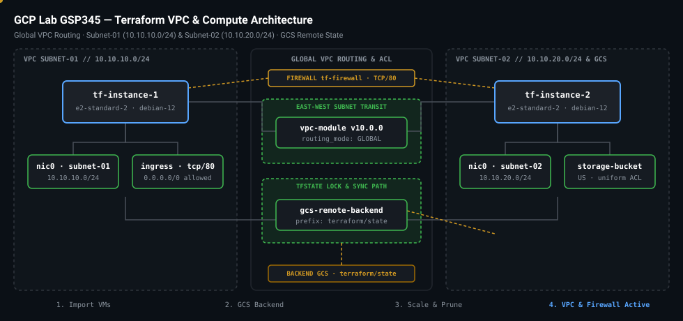

# TECHNICAL LOG & AUTOMATION ENGINEERING GUIDE

## TERRAFORM ON GCP (GSP345)
**CCNP Miguelangel Luna**

---

## CONTENIDOS:

| Case | Title | Description |
| :--- | :--- | :--- |
| **01** | [Claude & n8n AI Agents](./case-01-Google-Auth/) | Agentes Claude . |

[Google](https://www.google.com)

## 1. Introduction and Theoretical Framework

**Topologia:**



1. **Modular Structure:** Separation of concerns using root configuration (`main.tf`, `variables.tf`) and reusable local modules (`modules/instances`, `modules/storage`).
2. **Resource Import:** Importing pre-existing Compute Engine instances (`tf-instance-1`, `tf-instance-2`) into Terraform state.
3. **Remote State Backend:** Provisioning a GCS bucket and migrating local `terraform.tfstate` to a remote `gcs` backend.
4. **Lifecycle Management:** Scaling machine types (`n1-standard-1` → `e2-standard-2`), provisioning a third instance, and cleanly destroying it via declarative state updates.
5. **VPC & Firewall:** Deploying a custom global VPC with two regional subnets (`10.10.10.0/24`, `10.10.20.0/24`) using the official Google Terraform network module, migrating VM network interfaces, and opening HTTP ingress (TCP/80).


## 2. Topology and BGP Neighbor Establishment

**Variables de entorno:**

```text
export BUCKET="your-bucket-name"
export VPC="your-vpc-name"
export INSTANCE="your-instance-name"
export ZONE="your-zone"
export REGION="${ZONE%-*}"
export PROJECT_ID="$(gcloud config get-value project 2>/dev/null)"

gcloud config set compute/zone "$ZONE"
gcloud config set compute/region "$REGION"
```

**Estructura de carpetas:**

```text
.
├── main.tf
├── variables.tf
└── modules/
    ├── instances/
    │   ├── instances.tf
    │   ├── outputs.tf
    │   └── variables.tf
    └── storage/
        ├── storage.tf
        ├── outputs.tf
        └── variables.tf
```

**variables.tf (raíz, modules/instances/variables.tf y modules/storage/variables.tf)**

```text
variable "region" {
  type = string
}

variable "zone" {
  type = string
}

variable "project_id" {
  type = string
}
```

**modules/instances/instances.tf (estado final: VMs e2-standard-2 en subnet-01 y subnet-02):**

```text
resource "google_compute_instance" "tf-instance-1" {
  name         = "tf-instance-1"
  machine_type = "e2-standard-2"
  zone         = var.zone

  boot_disk {
    initialize_params {
      image = "debian-cloud/debian-12"
    }
  }

  network_interface {
    network    = var.vpc_name
    subnetwork = "subnet-01"
  }

  metadata_startup_script = <<-EOT
    #!/bin/bash
  EOT

  allow_stopping_for_update = true
}

resource "google_compute_instance" "tf-instance-2" {
  name         = "tf-instance-2"
  machine_type = "e2-standard-2"
  zone         = var.zone

  boot_disk {
    initialize_params {
      image = "debian-cloud/debian-12"
    }
  }

  network_interface {
    network    = var.vpc_name
    subnetwork = "subnet-02"
  }

  metadata_startup_script = <<-EOT
    #!/bin/bash
  EOT

  allow_stopping_for_update = true
}
```

**modules/storage/storage.tf:**

```text
resource "google_storage_bucket" "storage-bucket" {
  name                        = var.bucket_name
  location                    = "US"
  force_destroy               = true
  uniform_bucket_level_access = true
}
```

Define tf-instance-1 and tf-instance-2 in modules/instances/instances.tf:   

```text
terraform {
  backend "gcs" {
    bucket = "REPLACE_WITH_BUCKET"
    prefix = "terraform/state"
  }

  required_providers {
    google = {
      source  = "hashicorp/google"
      version = "~> 6.0"
    }
  }
}

provider "google" {
  project = var.project_id
  region  = var.region
  zone    = var.zone
}

module "vpc" {
  source       = "terraform-google-modules/network/google"
  version      = "10.0.0"
  project_id   = var.project_id
  network_name = var.vpc_name
  routing_mode = "GLOBAL"

  subnets = [
    {
      subnet_name   = "subnet-01"
      subnet_ip     = "10.10.10.0/24"
      subnet_region = var.region
    },
    {
      subnet_name   = "subnet-02"
      subnet_ip     = "10.10.20.0/24"
      subnet_region = var.region
    }
  ]
}

module "instances" {
  source   = "./modules/instances"
  zone     = var.zone
  vpc_name = module.vpc.network_name

  depends_on = [module.vpc]
}

module "storage" {
  source      = "./modules/storage"
  bucket_name = var.bucket_name
}

resource "google_compute_firewall" "tf-firewall" {
  name    = "tf-firewall"
  network = module.vpc.network_self_link

  allow {
    protocol = "tcp"
    ports    = ["80"]
  }

  source_ranges = ["0.0.0.0/0"]

  depends_on = [module.vpc]
}
```

## 3. IMPLEMENTATION:

**Parts 1 and 2:** Create a Python virtual environment (venv).
We are going to create an "isolated space" to install pyATS without affecting the VM's base system.

**1.1) Create the working folder and enter it::**

```text
python3 -m venv csr1kv
```

**1.2) Enter the virtual environment:**


**Part 3:** Use the pyATS Testing Library

**3.1) Install pyATS**

Inside the virtual environment (make sure you see (csr1kv) in your terminal), run:

```text
pip3 install pyats[full]
```


**3.2) Verify the installation**

Verify that it was installed correctly by running:

```text
pyats --help
```


