# TECHNICAL LOG & AUTOMATION ENGINEERING GUIDE

## TERRAFORM ON GCP (GSP345)
**CCNP Miguelangel Luna**

---

## CONTENIDOS:

| Case | Title | Description |
| :--- | :--- | :--- |
| **01** | [Claude & n8n AI Agents](./case-01-Google-Auth/) | Agentes Claude . |

[Google](https://www.google.com)

## 1. Introduction and Theoretical Framework

## 1. TAREA 1:

1.1)  Instalacion de TERRAFORM:

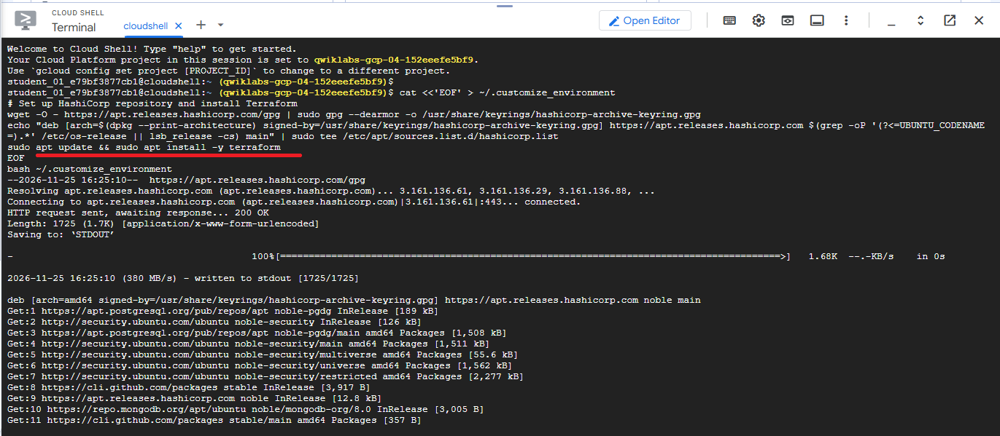


Paso 1: Crear la estructura de directorios y archivos vacíos
Ejecuta este bloque para crear las carpetas modules/instances y modules/storage junto con todos los archivos requeridos:

```text
mkdir -p modules/instances modules/storage
touch main.tf variables.tf
touch modules/instances/instances.tf modules/instances/outputs.tf modules/instances/variables.tf
touch modules/storage/storage.tf modules/storage/outputs.tf modules/storage/variables.tf
```

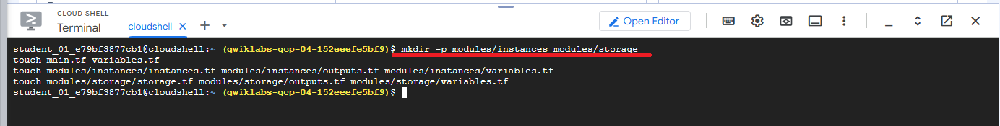


Paso 2: Rellenar los tres archivos variables.tf
El enunciado pide agregar las variables region, zone y project_id con sus valores por defecto en el variables.tf raíz y dentro de ambos módulos:

```text
cat << 'EOF' > variables.tf
variable "region" {
  description = "The GCP region"
  type        = string
  default     = "us-west1"
}

variable "zone" {
  description = "The GCP zone"
  type        = string
  default     = "us-west1-a"
}

variable "project_id" {
  description = "The GCP Project ID"
  type        = string
  default     = "qwiklabs-gcp-04-152eeefe5bf9"
}
EOF

cp variables.tf modules/instances/variables.tf
cp variables.tf modules/storage/variables.tf
```

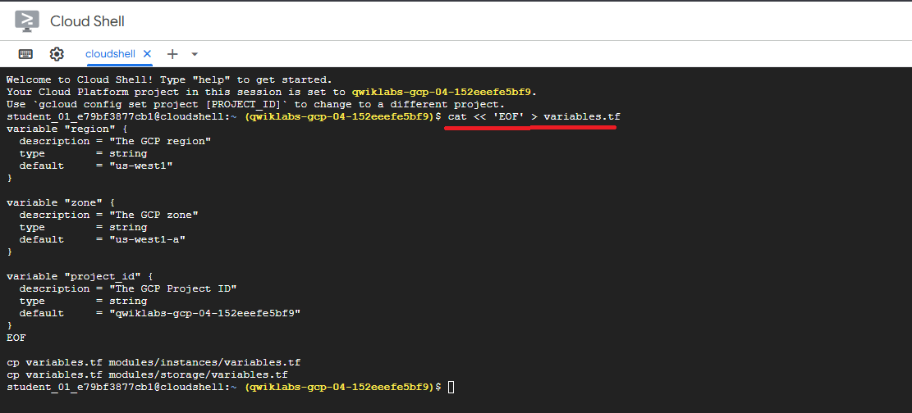


Paso 3: Configurar main.tf (Terraform block + Google Provider ~> 6.0)
Creamos main.tf con el bloque required_providers apuntando a hashicorp/google versión ~> 6.0 y el bloque provider "google" incluyendo project, region y zone:

```text
terraform {
  required_providers {
    google = {
      source  = "hashicorp/google"
      version = "~> 6.0"
    }
  }
}

provider "google" {
  project = var.project_id
  region  = var.region
  zone    = var.zone
}

module "instances" {
  source     = "./modules/instances"
  project_id = var.project_id
  region     = var.region
  zone       = var.zone
}
```

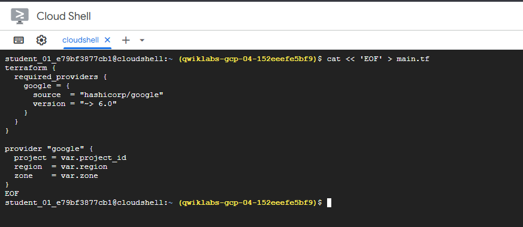


Paso 4: Inicializar Terraform
Ejecuta terraform init para descargar el proveedor de Google y verificar que no haya errores de sintaxis:


```text
terraform init
```

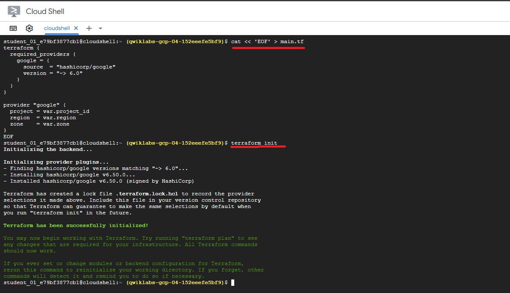


## 1. TAREA 2:

**Paso 1:** Consultar los datos exactos de tf-instance-1 y tf-instance-2 en Cloud Shell
Ejecuta este comando en Cloud Shell para ver la zona, el machine_type y el id de ambas instancias:

```text
gcloud compute instances list \
  --filter="name=('tf-instance-1','tf-instance-2')" \
  --format="table(name,zone,machineType.basename(),id)"
```

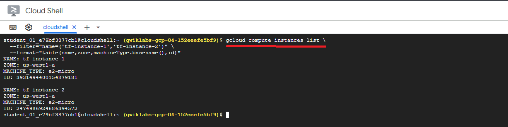


**Paso 2:** Escribir modules/instances/instances.tf

**2.1)** Ejecuta este bloque en Cloud Shell para definir los dos recursos con el formato mínimo requerido (debian-12, e2-micro, var.zone, metadata_startup_script y allow_stopping_for_update = true):

```text
cat << 'EOF' > modules/instances/instances.tf
resource "google_compute_instance" "tf-instance-1" {
  name         = "tf-instance-1"
  machine_type = "e2-micro"
  zone         = var.zone

  boot_disk {
    initialize_params {
      image = "debian-cloud/debian-12"
    }
  }

  network_interface {
    network = "default"
  }

  metadata_startup_script = <<-EOT
        #!/bin/bash
    EOT

  allow_stopping_for_update = true
}

resource "google_compute_instance" "tf-instance-2" {
  name         = "tf-instance-2"
  machine_type = "e2-micro"
  zone         = var.zone

  boot_disk {
    initialize_params {
      image = "debian-cloud/debian-12"
    }
  }

  network_interface {
    network = "default"
  }

  metadata_startup_script = <<-EOT
        #!/bin/bash
    EOT

  allow_stopping_for_update = true
}
EOF
```

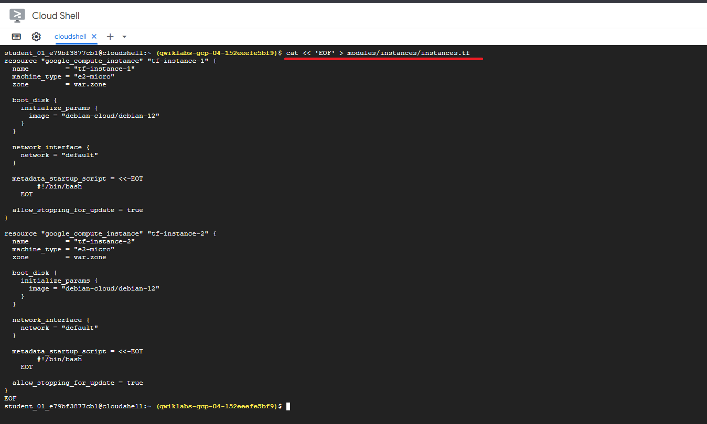


**2.2)** Importar ambas instancias al estado de Terraform:

Ejecuta estos dos comandos terraform import (usando los IDs exactos de tu salida):

```text
terraform import module.instances.google_compute_instance.tf-instance-1 3931494400154879181
terraform import module.instances.google_compute_instance.tf-instance-2 2474986924686394572
```

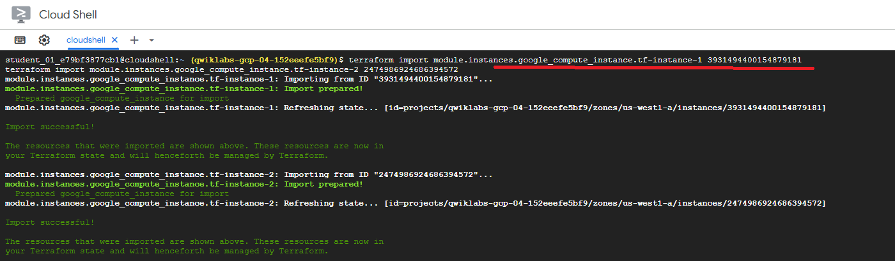


**2.3)** Siguiente paso para cerrar la Task 2
Ejecuta terraform plan y terraform apply -auto-approve para aplicar los cambios pendientes sobre las instancias importadas:

```text
terraform plan
terraform apply -auto-approve
```
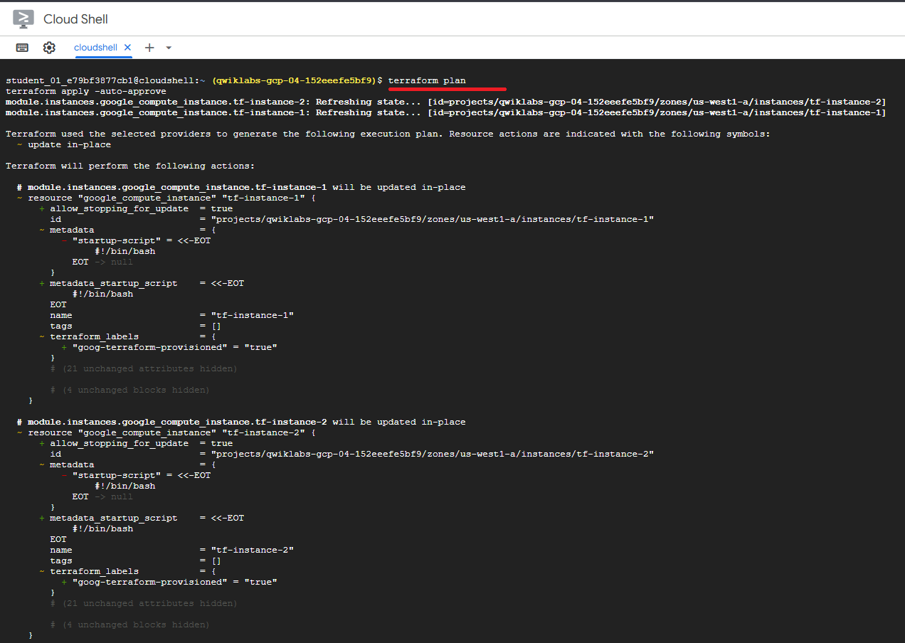

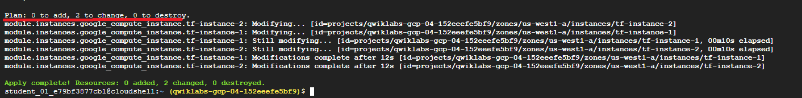

**Paso 3:** Escribir modules/instances/instances.tf

**3.1)** Crear el bucket en modules/storage/storage.tf (y salida opcional en outputs.tf):

Ejecuta este bloque para definir google_storage_bucket con name = "tf-bucket-732974", location = "US", force_destroy = true y uniform_bucket_level_access = true:

```text
cat << 'EOF' > modules/storage/storage.tf
resource "google_storage_bucket" "tf-bucket" {
  name                        = "tf-bucket-732974"
  location                    = "US"
  force_destroy               = true
  uniform_bucket_level_access = true
}
EOF

cat << 'EOF' > modules/storage/outputs.tf
output "bucket_name" {
  value = google_storage_bucket.tf-bucket.name
}
EOF
```

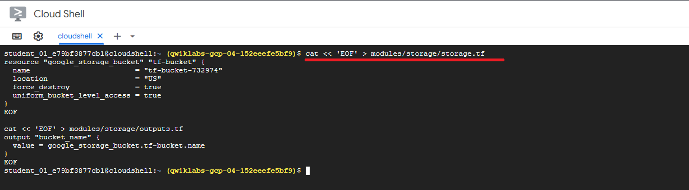


**3.2)** Agregar el módulo storage a main.tf, inicializar y crear el bucket

Primero agregamos module "storage" sin configurar todavía el backend "gcs", para que Terraform cree el bucket en Google Cloud antes de migrar el estado a él:

```text
cat << 'EOF' > main.tf
terraform {
  required_providers {
    google = {
      source  = "hashicorp/google"
      version = "~> 6.0"
    }
  }
}

provider "google" {
  project = var.project_id
  region  = var.region
  zone    = var.zone
}

module "instances" {
  source     = "./modules/instances"
  project_id = var.project_id
  region     = var.region
  zone       = var.zone
}

module "storage" {
  source     = "./modules/storage"
  project_id = var.project_id
  region     = var.region
  zone       = var.zone
}
EOF

terraform init
terraform plan
terraform apply -auto-approve
```

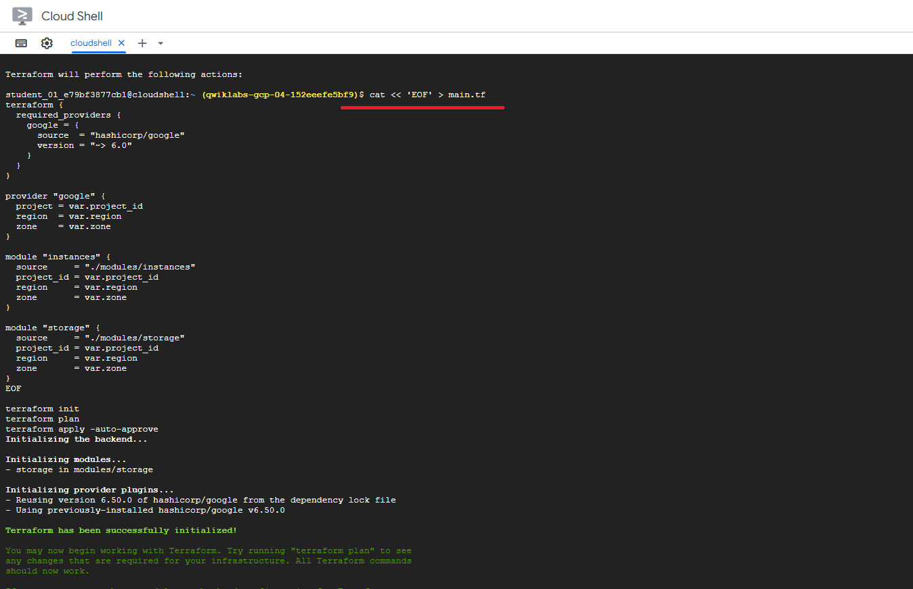


**3.3)** Configurar el backend remoto (gcs) en main.tf y migrar el estado:

Ahora que el bucket tf-bucket-732974 ya existe, actualizamos el bloque terraform en main.tf para incluir backend "gcs" con bucket = "tf-bucket-732974" y prefix = "terraform/state":

```text
cat << 'EOF' > main.tf
terraform {
  required_providers {
    google = {
      source  = "hashicorp/google"
      version = "~> 6.0"
    }
  }

  backend "gcs" {
    bucket = "tf-bucket-732974"
    prefix = "terraform/state"
  }
}

provider "google" {
  project = var.project_id
  region  = var.region
  zone    = var.zone
}

module "instances" {
  source     = "./modules/instances"
  project_id = var.project_id
  region     = var.region
  zone       = var.zone
}

module "storage" {
  source     = "./modules/storage"
  project_id = var.project_id
  region     = var.region
  zone       = var.zone
}
EOF

terraform init
```

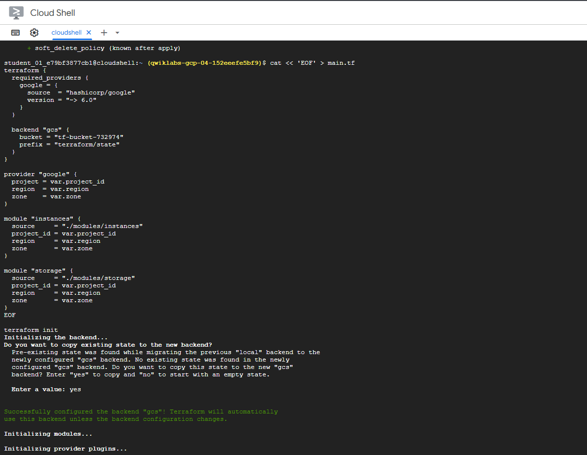

**Paso 4:**. Usaremos el nombre de la tercera instancia de tu panel del laboratorio (tf-instance-428597), el tipo de máquina e2-standard-2 para las tres instancias y la imagen debian-cloud/debian-12 para la tercera instancia.

Paso 1: Actualizar modules/instances/instances.tf (y opcionalmente outputs.tf)
Ejecuta este bloque en Cloud Shell para cambiar tf-instance-1 y tf-instance-2 a e2-standard-2 y agregar tf-instance-428597 con e2-standard-2 y debian-12:

```text
cat << 'EOF' > modules/instances/instances.tf
resource "google_compute_instance" "tf-instance-1" {
  name         = "tf-instance-1"
  machine_type = "e2-standard-2"
  zone         = var.zone

  boot_disk {
    initialize_params {
      image = "debian-cloud/debian-12"
    }
  }

  network_interface {
    network = "default"
  }

  metadata_startup_script = <<-EOT
        #!/bin/bash
    EOT

  allow_stopping_for_update = true
}

resource "google_compute_instance" "tf-instance-2" {
  name         = "tf-instance-2"
  machine_type = "e2-standard-2"
  zone         = var.zone

  boot_disk {
    initialize_params {
      image = "debian-cloud/debian-12"
    }
  }

  network_interface {
    network = "default"
  }

  metadata_startup_script = <<-EOT
        #!/bin/bash
    EOT

  allow_stopping_for_update = true
}

resource "google_compute_instance" "tf-instance-428597" {
  name         = "tf-instance-428597"
  machine_type = "e2-standard-2"
  zone         = var.zone

  boot_disk {
    initialize_params {
      image = "debian-cloud/debian-12"
    }
  }

  network_interface {
    network = "default"
  }

  metadata_startup_script = <<-EOT
        #!/bin/bash
    EOT

  allow_stopping_for_update = true
}
EOF

cat << 'EOF' > modules/instances/outputs.tf
output "instance_1_name" {
  value = google_compute_instance.tf-instance-1.name
}

output "instance_2_name" {
  value = google_compute_instance.tf-instance-2.name
}

output "instance_428597_name" {
  value = google_compute_instance.tf-instance-428597.name
}
EOF
```

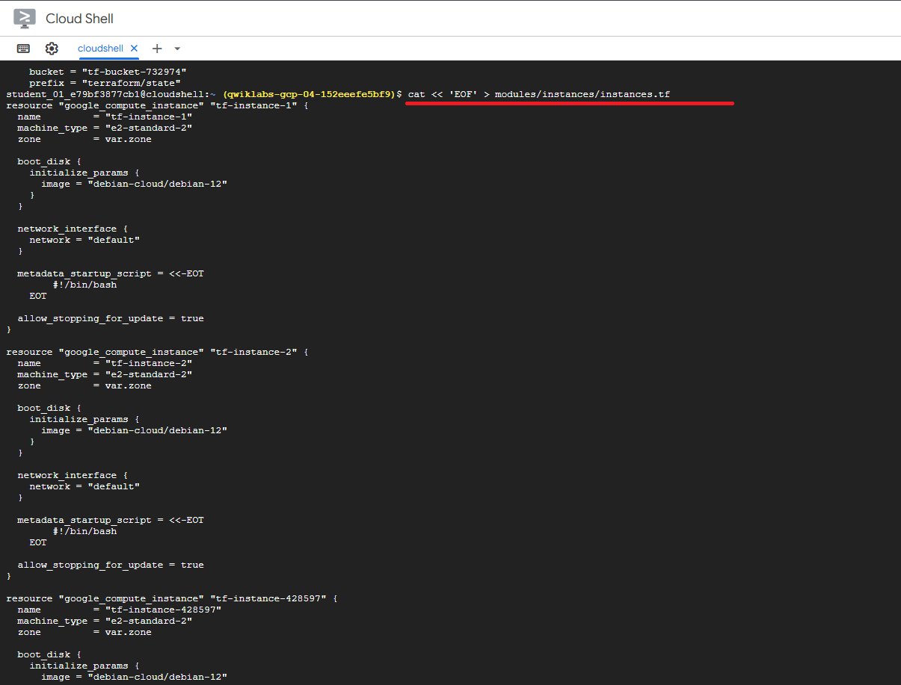


**Paso 4.2:** Inicializar, revisar el plan y aplicar los cambiosEjecuta estos comandos para que Terraform actualice el tamaño de las dos instancias existentes y cree tf-instance-428597:   

```text
terraform init
terraform plan
terraform apply -auto-approve
```

**Paso 5:**


**Paso 5.1:** debes eliminar el bloque resource "google_compute_instance" "tf-instance-428597" de tu archivo modules/instances/instances.tf (y limpiar su salida en modules/instances/outputs.tf si la agregaste en el paso anterior) y luego ejecutar terraform init y terraform apply para que Terraform destruya la instancia en Google Cloud.   Paso 1: Eliminar tf-instance-428597 de modules/instances/instances.tf (y outputs.tf)Ejecuta este bloque en Cloud Shell para dejar solo tf-instance-1 y tf-instance-2 en modules/instances/instances.tf y actualizar modules/instances/outputs.tf:

```text
cat << 'EOF' > modules/instances/instances.tf
resource "google_compute_instance" "tf-instance-1" {
  name         = "tf-instance-1"
  machine_type = "e2-standard-2"
  zone         = var.zone

  boot_disk {
    initialize_params {
      image = "debian-cloud/debian-12"
    }
  }

  network_interface {
    network = "default"
  }

  metadata_startup_script = <<-EOT
        #!/bin/bash
    EOT

  allow_stopping_for_update = true
}

resource "google_compute_instance" "tf-instance-2" {
  name         = "tf-instance-2"
  machine_type = "e2-standard-2"
  zone         = var.zone

  boot_disk {
    initialize_params {
      image = "debian-cloud/debian-12"
    }
  }

  network_interface {
    network = "default"
  }

  metadata_startup_script = <<-EOT
        #!/bin/bash
    EOT

  allow_stopping_for_update = true
}
EOF

cat << 'EOF' > modules/instances/outputs.tf
output "instance_1_name" {
  value = google_compute_instance.tf-instance-1.name
}

output "instance_2_name" {
  value = google_compute_instance.tf-instance-2.name
}
EOF
```

**Paso 5.1:** Reinicializar y aplicar los cambios para destruir tf-instance-428597
Ejecuta estos comandos en Cloud Shell:

```text
terraform init
terraform apply -auto-approve
```

**Paso 6:** Usaremos el módulo oficial de red de Google (terraform-google-modules/network/google) versión 10.0.0, el nombre de VPC de tu panel (tf-vpc-007596), modo de enrutamiento global (GLOBAL) y las dos subredes subnet-01 (10.10.10.0/24) y subnet-02 (10.10.20.0/24) en us-west1.   Paso 1: Agregar el módulo network en main.tf, inicializar y crear la VPC y subredesActualizamos main.tf con el bloque module "vpc" (versión 10.0.0), ejecutamos terraform init para descargar el módulo desde el Terraform Registry y aplicamos para crear la red y ambas subredes:

```text
cat << 'EOF' > main.tf
terraform {
  required_providers {
    google = {
      source  = "hashicorp/google"
      version = "~> 6.0"
    }
  }

  backend "gcs" {
    bucket = "tf-bucket-732974"
    prefix = "terraform/state"
  }
}

provider "google" {
  project = var.project_id
  region  = var.region
  zone    = var.zone
}

module "vpc" {
  source  = "terraform-google-modules/network/google"
  version = "10.0.0"

  project_id   = var.project_id
  network_name = "tf-vpc-007596"
  routing_mode = "GLOBAL"

  subnets = [
    {
      subnet_name   = "subnet-01"
      subnet_ip     = "10.10.10.0/24"
      subnet_region = "us-west1"
    },
    {
      subnet_name   = "subnet-02"
      subnet_ip     = "10.10.20.0/24"
      subnet_region = "us-west1"
    }
  ]
}

module "instances" {
  source     = "./modules/instances"
  project_id = var.project_id
  region     = var.region
  zone       = var.zone
}

module "storage" {
  source     = "./modules/storage"
  project_id = var.project_id
  region     = var.region
  zone       = var.zone
}
EOF

terraform init
terraform plan
terraform apply -auto-approve
```


El objetivo **(GSP345)** es crear una infraestructura en Google Cloud (una red VPC, subredes, instancias de VM y reglas de firewall) utilizando Terraform, siguiendo el flujo de trabajo de CI/CD con GitHub Actions.

**Estructura de carpetas:**

```text
.
├── main.tf
├── variables.tf
└── modules/
    ├── instances/
    │   ├── instances.tf
    │   ├── outputs.tf
    │   └── variables.tf
    └── storage/
        ├── storage.tf
        ├── outputs.tf
        └── variables.tf
```


Estructura de archivos:

**Archivo main.tf:**  Archivo de configuración principal de un proyecto Terraform, define la infraestructura que deseas crear, modificar o gestionar, ya sea declarando los recursos directamente o llamando a módulos que los contengan. Es el plano principal de tu infraestructura: es el lugar donde se describe, de forma legible, qué quieres construir en la nube.

**Ejemplo:**

```text
provider "google" {
  project = var.project_id
  region  = var.region
}

# 1. VPC Network
resource "google_compute_network" "vpc_network" {
  name                    = "tf-vpc-345"
  auto_create_subnetworks = false
}

# 2. Subnets
resource "google_compute_subnetwork" "subnet_1" {
  name          = "tf-subnet-1"
  ip_cidr_range = "10.0.1.0/24"
  region        = "us-central1"
  network       = google_compute_network.vpc_network.id
}

resource "google_compute_subnetwork" "subnet_2" {
  name          = "tf-subnet-2"
  ip_cidr_range = "10.0.2.0/24"
  region        = "europe-west1" # Región diferente para la segunda instancia
  network       = google_compute_network.vpc_network.id
}

# 3. Firewall Rule
resource "google_compute_firewall" "firewall_rule" {
  name    = "tf-firewall"
  network = google_compute_network.vpc_network.name

  allow {
    protocol = "tcp"
    ports    = ["22", "80"] # Permitir SSH (22) y HTTP (80)
  }

  source_ranges = ["0.0.0.0/0"] # Permite tráfico desde cualquier lugar (inseguro para producción, pero aceptable en labs)
}

# 4. Instances
resource "google_compute_instance" "instance_1" {
  name         = "tf-instance-1"
  machine_type = "e2-medium"
  zone         = "us-central1-a"
  tags         = ["web"] # Tag para aplicar la regla de firewall

  boot_disk {
    initialize_params {
      image = "debian-cloud/debian-11"
    }
  }

  network_interface {
    subnetwork = google_compute_subnetwork.subnet_1.name
    # Sin acceso a IP externa explícito; por defecto se asigna una efímera en GCP
  }
}

resource "google_compute_instance" "instance_2" {
  name         = "tf-instance-2"
  machine_type = "e2-medium"
  zone         = "europe-west1-b"
  tags         = ["web"] # Tag para aplicar la regla de firewall

  boot_disk {
    initialize_params {
      image = "debian-cloud/debian-11"
    }
  }

  network_interface {
    subnetwork = google_compute_subnetwork.subnet_2.name
    # Sin acceso a IP externa explícito; por defecto se asigna una efímera en GCP
  }
}
```
--------------------------------------------------------------------------------------

**Archivo variables.tf:**  Define los parámetros de entrada (valores que pueden cambiar)

```text
variable "project_id" {
  description = "The ID of the project where resources will be created"
  type        = string
}

variable "region" {
  description = "The region for the resources"
  type        = string
  default     = "us-central1" # Cambia esto si el lab pide otra
}
```

--------------------------------------------------------------------------------------

**Archivo backend.tf:**   (Configuración para guardar el estado de Terraform de forma remota en un Bucket de GCS).

```text
terraform {
  backend "gcs" {
    bucket  = "TU-BUCKET" # ELIMINAR: Sustituir por el nombre real del bucket creado
    prefix  = "terraform/state"
  }
}
```

--------------------------------------------------------------------------------------

## 3. Paso 3: Crear la Cuenta de Servicio de GCP para GitHub Actions.

GitHub Actions necesitará permisos para ejecutar Terraform en tu proyecto.


**3.1) Obtener el ID de tu proyecto::**

```text
PROJECT_ID=$(gcloud config get-value project)
echo $PROJECT_ID
```

**3.2) Crear la cuenta de servicios:**

```text
gcloud iam service-accounts create github-actions-sa \
    --display-name "GitHub Actions Service Account"
```

**3.3) Asignar roles necesarios (Editor/Project IAM Admin): El rol de Editor es suficiente para crear los recursos. En producción, se usarían roles más específicos**.

```text
gcloud projects add-iam-policy-binding $PROJECT_ID \
    --member="serviceAccount:github-actions-sa@$PROJECT_ID.iam.gserviceaccount.com" \
    --role="roles/editor"
```

**3.4)** Crear la clave JSON de la cuenta de servicio:**

```text
gcloud iam service-accounts keys create gcp-key.json \
    --iam-account="github-actions-sa@$PROJECT_ID.iam.gserviceaccount.com"
```

**IMPORTANTE:** El contenido del archivo gcp-key.json se usará en la configuración de GitHub. No subas este archivo a tu repositorio público.

##  Parte 4: Configuración en GitHub (Repositorio y Actions):

En este punto, configurarás tu repositorio de GitHub para almacenar el código y ejecutar el flujo de CI/CD.

**4.1)Subir el código a GitHub:**

Paso 1:
Inicializar Git y conectar con tu repositorio remoto:Si ya clonaste el repo base, salta este paso y ve a "Paso 2: Configurar Secretos".

# Si empezaste desde cero:
```text
git init
git remote add origin git@github.com:TU_USUARIO/TU_REPOSITORIO.git
```

**4.2)Crear un archivo .gitignore (para no subir archivos sensibles)::**

```text
echo ".terraform/" >> .gitignore
echo "terraform.tfstate" >> .gitignore
echo "terraform.tfstate.backup" >> .gitignore
echo "*.tfvars" >> .gitignore
echo "gcp-key.json" >> .gitignore # Crucial
```

**4.3)Hacer commit y push del código de Terraform:**.

```text
git add .
git commit -m "Initial Terraform configuration"
git push -u origin main
```

##  Parte 5:  Configurar Secretos de GitHub

GitHub Actions necesita acceder a tus credenciales de GCP de forma segura.

**5.1) Ve a tu repositorio en GitHub -> Settings (Configuración).**

En el menú de la izquierda, busca Security -> Secrets and variables -> Actions.

Haz clic en New repository secret.

Crea el siguiente secreto:

Name: GCP_CREDENTIALS

Value: Pega todo el contenido de tu archivo gcp-key.json que generaste en la Parte 1, Paso 3.

Haz clic en Add secret.

También es buena práctica agregar el GCP_PROJECT_ID para simplificar el workflow.
6.  Crea otro secreto:
*   Name: GCP_PROJECT_ID
*   Value: El ID de tu proyecto de GCP (ej. qwiklabs-gcp-04-7c...).

##  Parte 6: Crear el Workflow de GitHub Actions:

Este archivo define los pasos que se ejecutarán automáticamente al hacer push al repositorio.

En tu repositorio en GitHub, ve a la pestaña Actions y haz clic en "set up a workflow yourself".

Esto abrirá un editor de texto con un archivo llamado main.yml (o terraform.yml) dentro de la carpeta .github/workflows/.

Pega el siguiente código YAML (asegúrate de que el nombre del bucket en main.tf y en la variable de entorno coincida):

```text
name: "Terraform CI/CD Workflow"

on:
  push:
    branches:
      - main # Ejecutar solo al hacer push a la rama main

env:
  # Define las variables de entorno que usará el workflow
  GCP_PROJECT_ID: ${{ secrets.GCP_PROJECT_ID }}
  TF_STATE_BUCKET: "TU-BUCKET" # ELIMINAR: Sustituir por el nombre real del bucket
  GOOGLE_CREDENTIALS: ${{ secrets.GCP_CREDENTIALS }} # Necesario para que el proveedor de Google se autentique

jobs:
  terraform:
    runs-on: ubuntu-latest

    steps:
      # 1. Checkout del código
      - name: Checkout
        uses: actions/checkout@v3

      # 2. Instalar Terraform
      - name: Setup Terraform
        uses: hashicorp/setup-terraform@v2
        # with:
        #   terraform_version: 1.5.7 # Opcional, fija la versión

      # 3. Terraform Init
      - name: Terraform Init
        id: init
        # El backend.tf ya apunta al bucket remoto. Se usa la autenticación definida en GOOGLE_CREDENTIALS.
        run: terraform init

      # 4. Terraform Validate
      - name: Terraform Validate
        id: validate
        run: terraform validate -no-color

      # 5. Terraform Plan
      - name: Terraform Plan
        id: plan
        # Ejecuta el plan para ver qué cambios se realizarán. -no-color para logs limpios.
        run: terraform plan -no-color

      # 6. Terraform Apply
      - name: Terraform Apply
        # Ejecutar 'apply' SOLO si el push ocurre en la rama main y el plan fue exitoso.
        if: github.ref == 'refs/heads/main' && github.event_name == 'push'
        run: terraform apply -auto-approve -input=false
```

Parte 7: Verificación y Ejecución del Flujo
Al hacer commit del archivo terraform.yml, el workflow de GitHub Actions se iniciará automáticamente.

Ve a la pestaña Actions de tu repositorio para ver el progreso.

Si el workflow falla en Terraform Plan, revisa los logs para corregir errores en tus archivos .tf (normalmente de sintaxis o permisos).

Si el workflow llega a Terraform Apply y termina con éxito, GitHub Actions habrá creado tu infraestructura en GCP.

Verificación final en GCP (Opcional pero recomendado):

Entra a la consola de Google Cloud.

Ve a VPC networks -> tf-vpc-345.

Ve a VM instances -> tf-instance-1 y tf-instance-2.

Verifica que ambas VMs existan, estén corriendo y tengan acceso a la red correcta.

Verifica que la regla de firewall tf-firewall esté aplicada.


**Topologia:**


1. **Modular Structure:** Separation of concerns using root configuration (`main.tf`, `variables.tf`) and reusable local modules (`modules/instances`, `modules/storage`).
2. **Resource Import:** Importing pre-existing Compute Engine instances (`tf-instance-1`, `tf-instance-2`) into Terraform state.
3. **Remote State Backend:** Provisioning a GCS bucket and migrating local `terraform.tfstate` to a remote `gcs` backend.
4. **Lifecycle Management:** Scaling machine types (`n1-standard-1` → `e2-standard-2`), provisioning a third instance, and cleanly destroying it via declarative state updates.
5. **VPC & Firewall:** Deploying a custom global VPC with two regional subnets (`10.10.10.0/24`, `10.10.20.0/24`) using the official Google Terraform network module, migrating VM network interfaces, and opening HTTP ingress (TCP/80).


## 2. Topology and BGP Neighbor Establishment


**1)** Instalacion de Terraform:

**cat <<'EOF' > ~/.customize_environment ... EOF: Escribe bloque de texto en un archivo llamado (customize_environment)**

**1.1)** Descarga la clave publica GPG de HashiCorp asegurando que durante la instalacion todos los paquetes que se descarguen sean legitimos.

**wget -O - https://apt.releases.hashicorp.com/gpg | sudo gpg --dearmor -o /usr/share/keyrings/hashicorp-archive-keyring.gpg**

**1.2)** Registra (agregar) su repositorio APT, crear archivo de texto (hashicorp.list) con una línea que le dice a apt dónde buscar los paquetes al ejecutar apt update o apt install.

**echo "deb [arch=$(dpkg --print-architecture) signed-by=/usr/share/keyrings/hashicorp-archive-keyring.gpg] https://apt.releases.hashicorp.com $(grep -oP '(?<=UBUNTU_CODENAME=).*' /etc/os-release || lsb_release -cs) main" | sudo tee /etc/apt/sources.list.d/hashicorp.list**

**1.3)** instala Terraform. Luego lo ejecuta para aplicarlo de inmediato.

**sudo apt update && sudo apt install -y terraform**

Hacer todo mediante el siguiente script:

```text
cat <<'EOF' > ~/.customize_environment
# Set up HashiCorp repository and install Terraform
wget -O - https://apt.releases.hashicorp.com/gpg | sudo gpg --dearmor -o /usr/share/keyrings/hashicorp-archive-keyring.gpg
echo "deb [arch=$(dpkg --print-architecture) signed-by=/usr/share/keyrings/hashicorp-archive-keyring.gpg] https://apt.releases.hashicorp.com $(grep -oP '(?<=UBUNTU_CODENAME=).*' /etc/os-release || lsb_release -cs) main" | sudo tee /etc/apt/sources.list.d/hashicorp.list
sudo apt update && sudo apt install -y terraform
EOF
bash ~/.customize_environment
```

**1.4)** Verificar que Terraform se ha instalado correctamente:

```text
terraform --version
```

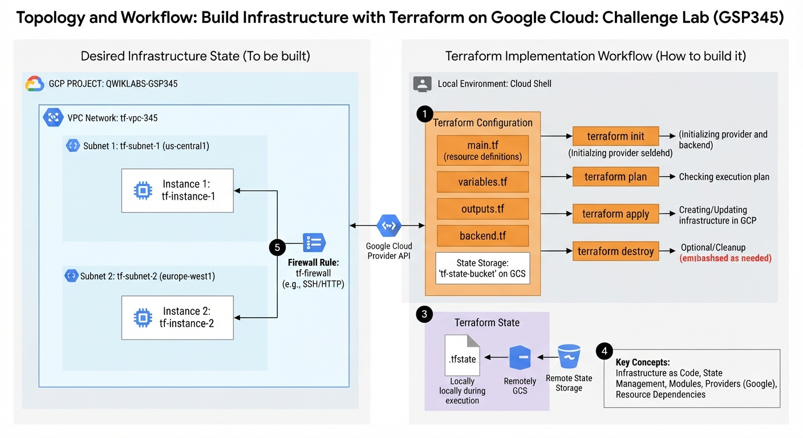


## 3. IMPLEMENTATION:

**Variables de entorno:**

```text
export BUCKET="your-bucket-name"
export VPC="your-vpc-name"
export INSTANCE="your-instance-name"
export ZONE="your-zone"
export REGION="${ZONE%-*}"
export PROJECT_ID="$(gcloud config get-value project 2>/dev/null)"

gcloud config set compute/zone "$ZONE"
gcloud config set compute/region "$REGION"
```


Define los valores para tu proyecto y región, en el file **variables.tf (raíz, modules/instances/variables.tf y modules/storage/variables.tf)** 

```text
variable "region" {
  type = string
}

variable "zone" {
  type = string
}

variable "project_id" {
  type = string
}
```

**modules/instances/instances.tf (estado final: VMs e2-standard-2 en subnet-01 y subnet-02):**

```text
resource "google_compute_instance" "tf-instance-1" {
  name         = "tf-instance-1"
  machine_type = "e2-standard-2"
  zone         = var.zone

  boot_disk {
    initialize_params {
      image = "debian-cloud/debian-12"
    }
  }

  network_interface {
    network    = var.vpc_name
    subnetwork = "subnet-01"
  }

  metadata_startup_script = <<-EOT
    #!/bin/bash
  EOT

  allow_stopping_for_update = true
}

resource "google_compute_instance" "tf-instance-2" {
  name         = "tf-instance-2"
  machine_type = "e2-standard-2"
  zone         = var.zone

  boot_disk {
    initialize_params {
      image = "debian-cloud/debian-12"
    }
  }

  network_interface {
    network    = var.vpc_name
    subnetwork = "subnet-02"
  }

  metadata_startup_script = <<-EOT
    #!/bin/bash
  EOT

  allow_stopping_for_update = true
}
```

**modules/storage/storage.tf:**

```text
resource "google_storage_bucket" "storage-bucket" {
  name                        = var.bucket_name
  location                    = "US"
  force_destroy               = true
  uniform_bucket_level_access = true
}
```

Define tf-instance-1 and tf-instance-2 in modules/instances/instances.tf:   

```text
terraform {
  backend "gcs" {
    bucket = "REPLACE_WITH_BUCKET"
    prefix = "terraform/state"
  }

  required_providers {
    google = {
      source  = "hashicorp/google"
      version = "~> 6.0"
    }
  }
}

provider "google" {
  project = var.project_id
  region  = var.region
  zone    = var.zone
}

module "vpc" {
  source       = "terraform-google-modules/network/google"
  version      = "10.0.0"
  project_id   = var.project_id
  network_name = var.vpc_name
  routing_mode = "GLOBAL"

  subnets = [
    {
      subnet_name   = "subnet-01"
      subnet_ip     = "10.10.10.0/24"
      subnet_region = var.region
    },
    {
      subnet_name   = "subnet-02"
      subnet_ip     = "10.10.20.0/24"
      subnet_region = var.region
    }
  ]
}

module "instances" {
  source   = "./modules/instances"
  zone     = var.zone
  vpc_name = module.vpc.network_name

  depends_on = [module.vpc]
}

module "storage" {
  source      = "./modules/storage"
  bucket_name = var.bucket_name
}

resource "google_compute_firewall" "tf-firewall" {
  name    = "tf-firewall"
  network = module.vpc.network_self_link

  allow {
    protocol = "tcp"
    ports    = ["80"]
  }

  source_ranges = ["0.0.0.0/0"]

  depends_on = [module.vpc]
}
```


**Paso 1:** Subir el código a GitHub:

```text
git init
git remote add origin git@github.com:TU_USUARIO/TU_REPOSITORIO.git
```

**Paso 2:** Crear un archivo .gitignore (para no subir archivos sensibles):

```text
echo ".terraform/" >> .gitignore
echo "terraform.tfstate" >> .gitignore
echo "terraform.tfstate.backup" >> .gitignore
echo "*.tfvars" >> .gitignore
echo "gcp-key.json" >> .gitignore # Crucial
```

**Paso 3:**  Hacer commit y push del código de Terraform:

```text
git add .
git commit -m "Initial Terraform configuration"
git push -u origin main

```
