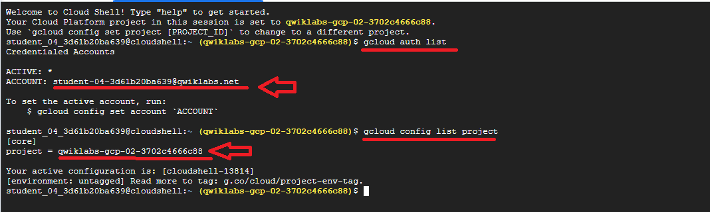
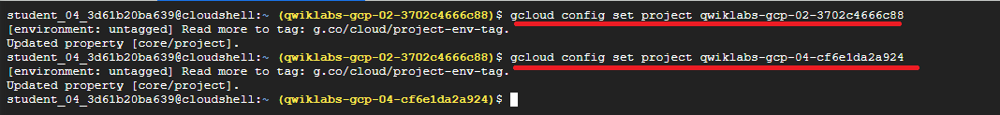
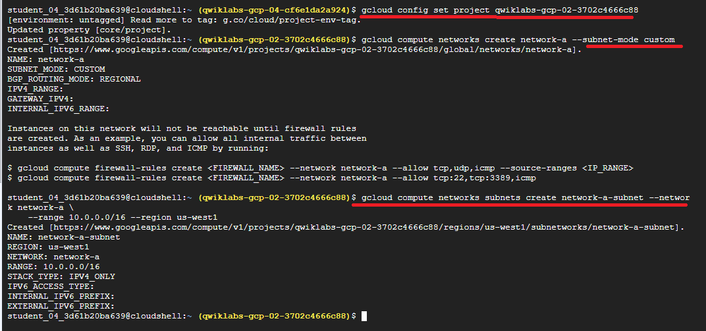
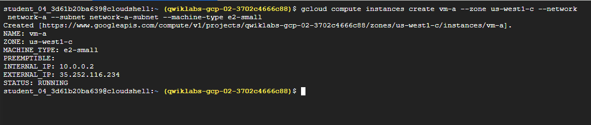
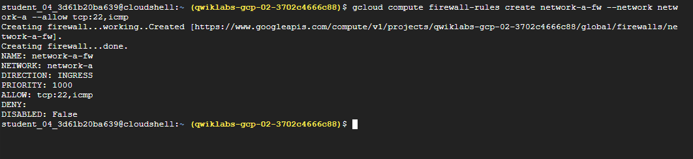
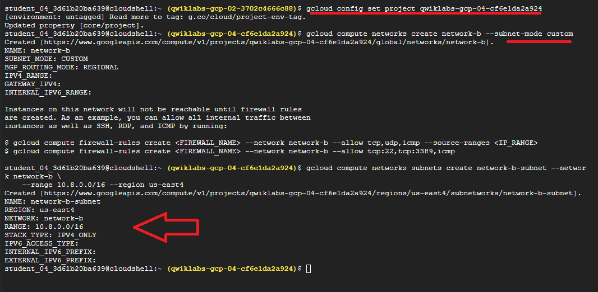
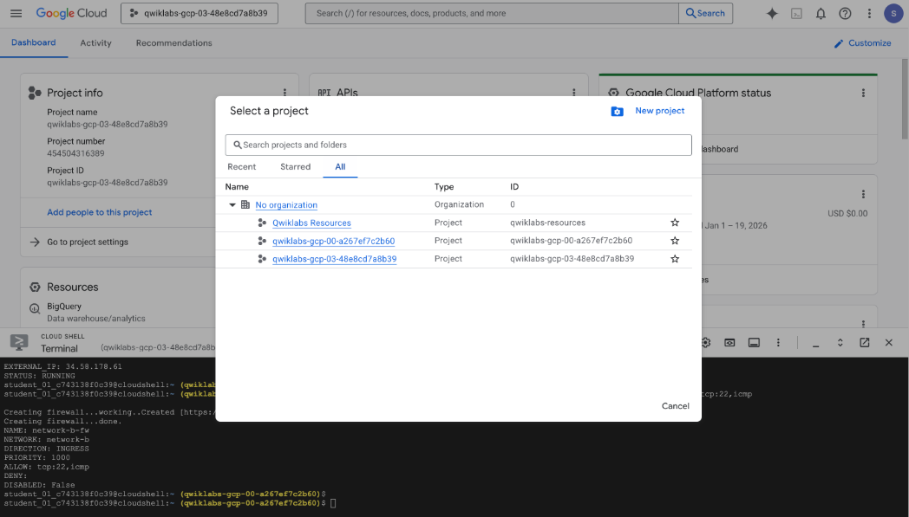
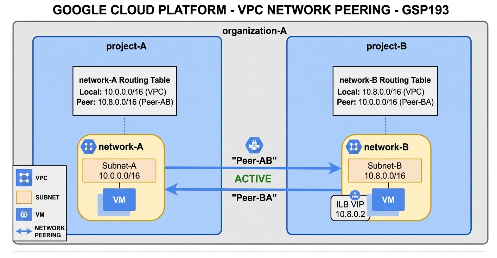

# TECHNICAL LOG & VPC PEERING

## VPC PEERING
**CCNP Miguelangel Luna**

---

## CONTENIDOS:

| Case | Title | Description |
| :--- | :--- | :--- |
| **01** | [Claude & n8n AI Agents](./case-01-Google-Auth/) | Agentes Claude . |


[Google](https://www.google.com)

## 1. Introduction and Theoretical Framework


## 2. Topology and BGP Neighbor Establishment


## 3. Configuration:




**Task 1: Create a Custom Network in Both Projects:**

Within the same organization node, a network can host services that need to be accessible from other VPC networks in the same or different projectsAlternatively, an organization may want to access services offered by a third-party provider.

Project names are unique across all of Google Cloud, so you do not need to specify the organization when setting up peering. Google Cloud identifies the organization based on the project name.

In this lab, you have been provisioned two projects: the first project is `project-A`, and the second is `project-B`.

**1.1** In each project, start a new Cloud Shell session by clicking the **+** icon.
**1.2** In the Cloud Shell for `project-A`, set the project ID for `project-A`:

```text
gcloud config set project Project ID 1
```

```text
gcloud config set project qwiklabs-gcp-02-3702c4666c88
```

```text
gcloud config set project Project ID 2
```
```text
gcloud config set project qwiklabs-gcp-04-cf6e1da2a924
```


### Project A

Context PROJECT-A

```text
gcloud config set project qwiklabs-gcp-02-3702c4666c88
```

**1.3** Return to the first Cloud Shell tab and run the following command to create a custom network:

```text
gcloud compute networks create network-a --subnet-mode custom
```

**1.4** Create a subnet within this VPC and specify a region and IP range by running:
  
```text
gcloud compute networks subnets create network-a-subnet --network network-a \
    --range 10.0.0.0/16 --region "REGION 1"
```
```text
gcloud compute networks subnets create network-a-subnet --network network-a \
    --range 10.0.0.0/16 --region us-west1
```


**1.5**  Create a VM instance:

```text
gcloud compute instances create vm-a --zone "ZONE 1" --network network-a --subnet network-a-subnet --machine-type e2-small
```


**1.6** Run the following command to enable SSH and ICMP, as you will need a secure shell to communicate with VMs during connectivity testing:

```text
gcloud compute firewall-rules create network-a-fw --network network-a --allow tcp:22,icmp
```


**Next you set up Project-B in the same way..**


### Project B

Context PROJECT-B

```text
gcloud config set project qwiklabs-gcp-04-cf6e1da2a924
```
**1.7** Switch to the second Cloud Shell tab and create a custom network:

```text
gcloud compute networks create network-b --subnet-mode custom
```

**1.8** Create a subnet within this VPC and specify a region and IP range by running:

```text
gcloud compute networks subnets create network-b-subnet --network network-b \
    --range 10.8.0.0/16 --region "REGION 2"
```

```text
gcloud compute networks subnets create network-b-subnet --network network-b \
    --range 10.8.0.0/16 --region us-east4
```




**1.9** Create a VM instance:

```text
gcloud compute instances create vm-b --zone "ZONE 2" --network network-b --subnet network-b-subnet --machine-type e2-small
```

```text
gcloud compute instances create vm-b --zone us-east4-c --network network-b --subnet network-b-subnet --machine-type e2-small
```


**1.10** Run the following to enable SSH and icmp, because you'll need a secure shell to communicate with VMs during connectivity testing:

```text
gcloud compute firewall-rules create network-b-fw --network network-b --allow tcp:22,icmp
```
```text
gcloud compute firewall-rules create network-b-fw --network network-b --allow tcp:22,icmp
```


## Task 2: Set Up a VPC Network Peering Session

Consider an organization that needs to establish VPC Network Peering between `network-A` in `project-A` and `network-B` in `project-B`. To establish VPC Network Peering successfully, the administrators of `network-A` and `network-B` must separately configure their respective sides of the peering association.

### Peer `network-A` with `network-B`:


At the top of the screen, click the Project 1 name. Ensure you are on the **All** tab, then select the correct project ID in the console before applying the settings.



### Project A

Go to the **VPC Network Peering** page in the Google Cloud Console by navigating to the **Networking** section and selecting **VPC Network > VPC Connectivity > VPC network peering** tab. Once there:

1. Click **Create connection**.
2. Click **Continue**.
3. Type `peer-ab` as the **Name** for this side of the connection.
4. Under **Your VPC network**, select the network you want to peer (`network-a`).
5. Set the **Peered VPC network** radio button to **In another project**.
6. Paste the **Project ID** of the second project.

```text
"PROJECT ID 2"
```

7.Type in the VPC network name of the other network (network-b).
8. Click Create.


### Project-B



1. Click Create connection.
2. Click Continue.
3. Type "peer-ba" as the Name for this side of the connection.
4. Under Your VPC network, select the network you want to peer (network-b).
5. Set the Peering VPC network radio buttons to In another project, unless you wish to peer within the same project.
6. Specify the Project ID of the first project.

```text
"PROJECT ID 1"
```
7. Specify the **VPC network name** of the peered network (`network-a`).
8. Click **Create**.

> **Note:** In the **VPC network peering** section, you should now see `peer-ba` listed in the properties list.

---

### Understanding VPC Network Peering States

VPC Network Peering becomes **ACTIVE** and routes are exchanged automatically once both ends of the peering connection are configured. As soon as the peering transitions to an **ACTIVE** state, the following traffic flows are established:

- **Between VM instances in the peered networks:** Full-mesh IP connectivity.
- **From VM instances in one network to Internal Load Balancing endpoints in the peered network.**

> **Current Status:** At this point, the peering state remains **INACTIVE** because there is no matching peering configuration in `network-b` within `project-B`. You will see the status message: *"Waiting for the connection to be created by network-b."*

Once peering is active, routes to peered network CIDR prefixes become visible across the VPC network peers. These routes are **implicit routes** generated automatically for active peerings; they do not exist as standalone, manually managed route resources.

Run the following command to list routes for all VPC networks in `project-A`:
```text
gcloud compute routes list --project
```

## Task 3: Test Connectivity

In this task, you will perform a connectivity test between instances across the peered networks.

### Project A

1. Navigate to the VM instances page in the Cloud Console by clicking **Navigation menu > Compute Engine > VM instances**.
2. Copy the **Internal IP** address (`INTERNAL_IP`) for `vm-a`.

### Project B

1. Click **Navigation menu > Compute Engine > VM instances**.
2. Connect via SSH to the `vm-b` instance by clicking **SSH** next to the VM name.
3. In the SSH terminal of `vm-b`, run the following command, replacing `<INTERNAL_IP_OF_VM_A>` with the internal IP address of `vm-a`:

   
