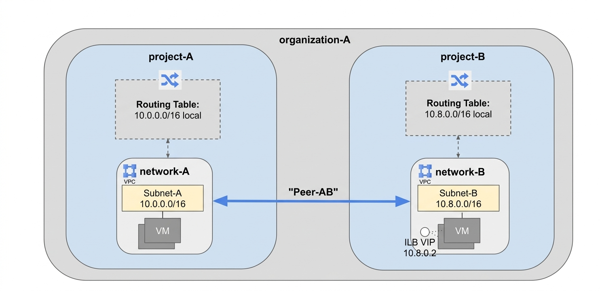

# TECHNICAL LOG & BGP ENGINEERING GUIDE

## VPC PEERING
**CCNP Miguelangel Luna**

---

## CONTENIDOS:

| Case | Title | Description |
| :--- | :--- | :--- |
| **01** | [Claude & n8n AI Agents](./case-01-Google-Auth/) | Agentes Claude . |


[Google](https://www.google.com)

## 1. Introduction and Theoretical Framework


## 2. Topology and BGP Neighbor Establishment


 

## 3. BGP Configuration:

**Task 1: Create a Custom Network in Both Projects:**

Within the same organization node, a network can host services that need to be accessible from other VPC networks in the same or different projectsAlternatively, an organization may want to access services offered by a third-party provider.

Project names are unique across all of Google Cloud, so you do not need to specify the organization when setting up peering. Google Cloud identifies the organization based on the project name.

In this lab, you have been provisioned two projects: the first project is `project-A`, and the second is `project-B`.

**1.1** In each project, start a new Cloud Shell session by clicking the **+** icon.
**1.2** In the Cloud Shell for `project-A`, set the project ID for `project-A`:

```text
gcloud config set project Project ID 1
```

```text
gcloud config set project Project ID 2
```
### Project A

**1.3** Return to the first Cloud Shell tab and run the following command to create a custom network:

```text
gcloud compute networks create network-a --subnet-mode custom
```

**1.4** Create a subnet within this VPC and specify a region and IP range by running:
  
```text
gcloud compute networks subnets create network-a-subnet --network network-a \
    --range 10.0.0.0/16 --region "REGION 1"
```

**1.5**  Create a VM instance:

```text
gcloud compute instances create vm-a --zone "ZONE 1" --network network-a --subnet network-a-subnet --machine-type e2-small
```
**1.6** Run the following command to enable SSH and ICMP, as you will need a secure shell to communicate with VMs during connectivity testing:

```text
gcloud compute firewall-rules create network-a-fw --network network-a --allow tcp:22,icmp
```

**Next you set up Project-B in the same way..**


### Project B

**1.7** Switch to the second Cloud Shell tab and create a custom network:

```text
gcloud compute networks create network-b --subnet-mode custom
```

**1.8** Create a subnet within this VPC and specify a region and IP range by running:

```text
gcloud compute networks subnets create network-b-subnet --network network-b \
    --range 10.8.0.0/16 --region "REGION 2"
```

**1.9** Create a VM instance:

```text
gcloud compute instances create vm-b --zone "ZONE 2" --network network-b --subnet network-b-subnet --machine-type e2-small
```

**1.10** Run the following to enable SSH and icmp, because you'll need a secure shell to communicate with VMs during connectivity testing:

```text
gcloud compute firewall-rules create network-b-fw --network network-b --allow tcp:22,icmp
```

## Task 2: Set Up a VPC Network Peering Session

Consider an organization that needs to establish VPC Network Peering between `network-A` in `project-A` and `network-B` in `project-B`. To establish VPC Network Peering successfully, the administrators of `network-A` and `network-B` must separately configure their respective sides of the peering association.

### Peer `network-A` with `network-B`:




### 4. BGP Configuration:

