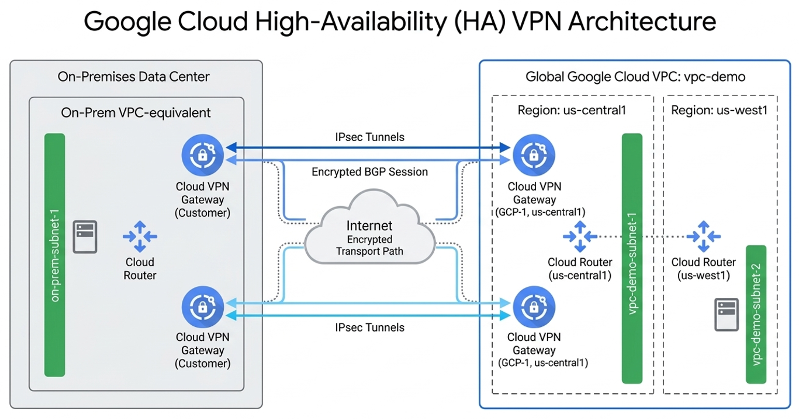

# TECHNICAL LOG & BGP ENGINEERING GUIDE Visualizing GCP Network Performance: Cloud HA VPN

## Traffic Manipulation via the Weight Attribute
**CCNP Miguelangel Luna**

---

## CONTENT:

| Case | Title | Description |
| :--- | :--- | :--- |
| **01** | [Claude & n8n AI Agents](./case-01-Google-Auth/) | Agentes Claude . |


[Google Skills](https://www.skills.google/)

An end-to-end hands-on demonstration of configuring, testing, and optimizing high-availability hybrid connectivity using **Google Cloud HA VPN** and dynamic BGP routing between Google Cloud VPCs and simulated on-premises environments.

---

## Architecture Overview (Topology) 

This project simulates a hybrid enterprise environment connecting a production VPC in Google Cloud (`vpc-demo`) to a remote simulated data center (`on-prem`) via Cloud HA VPN over public internet infrastructure.

```
+----------------------------------------+              +----------------------------------------+
|               vpc-demo                 |              |                on-prem                 |
|            (Region: us-west1)          |              |           (Region: us-west1)           |
|                                        |              |                                        |
|  Subnet: 10.1.2.0/24                   |              |  Subnet: 192.168.1.0/24                |
|  Cloud Router: vpc-demo-router1        |              |  Cloud Router: on-prem-router1          |
|  ASN: 65001                            |              |  ASN: 65002                            |
|                                        |              |                                        |
|         [ HA VPN Gateway ]             |<============>|         [ HA VPN Gateway ]             |
|         - Tunnel 0 (BGP Session 0)     |  IPsec Tunnels - Tunnel 0 (BGP Session 0)     |
|         - Tunnel 1 (BGP Session 1)     |              |  - Tunnel 1 (BGP Session 1)     |
+----------------------------------------+              +----------------------------------------+
```



---

## Technical Specifications

| Parameter | VPC Environment (`vpc-demo`) | Simulated On-Prem Environment (`on-prem`) |
| :--- | :--- | :--- |
| **VPC Region** | `us-west1` | `us-west1` |
| **Subnet Range** | `10.1.2.0/24` | `192.168.1.0/24` |
| **BGP Autonomous System Number (ASN)** | `65001` | `65002` |
| **Router Name** | `vpc-demo-router1` | `on-prem-router1` |
| **VPN Gateway Name** | `vpc-demo-vpn-gw1` | `on-prem-vpn-gw1` |
| **High Availability SLA** | 99.99% Availability | 99.99% Availability |

---

## Implementation Steps (Configuration)

### 1. Prerequisites & VPC Preparation
Ensure both Google Cloud Virtual Private Clouds (VPCs) and their respective subnets are initialized:
* **Cloud VPC (`vpc-demo`)**: Contains workload subnets representing production infrastructure.
* **On-Prem VPC (`on-prem`)**: Represents external corporate network infrastructure.

### 2. Cloud Router Configuration
Deploy Cloud Routers in both networks to manage dynamic BGP route exchanges.

**Cloud Router (`vpc-demo-router1`):**
```bash
gcloud compute routers create vpc-demo-router1 \
    --region us-west1 \
    --network vpc-demo \
    --asn 65001
```

**On-Prem Router (`on-prem-router1`):**
```bash
gcloud compute routers create on-prem-router1 \
    --region us-west1 \
    --network on-prem \
    --asn 65002
```

### 3. HA VPN Gateway Deployment
Create high-availability dual-interface VPN gateways in both networks:
* `vpc-demo-vpn-gw1`
* `on-prem-vpn-gw1`

### 4. IPsec Tunnels & BGP Peering
Establish cross-connected IPsec encrypted tunnels between gateway interfaces:
* **Tunnel 0**: Connects Gateway 1 (Interface 0) to Gateway 2 (Interface 0).
* **Tunnel 1**: Connects Gateway 1 (Interface 1) to Gateway 2 (Interface 1).
* Configure BGP sessions on top of both tunnels to enable dynamic topology propagation and immediate failover.

---

## Network Performance & Path Verification

### Routing & Failover Test Matrix
* **Active-Active Forwarding**: Traffic load-balances across both operational IPsec tunnels.
* **Path Resilience**: Disconnecting Interface 0 triggers automatic BGP route convergence to Interface 1 without traffic loss.

---

## Key Features & Production Considerations
* **SLA Compliance**: Dual-tunnel layout achieves GCP's top 99.99% availability tier.
* **Dynamic Routing**: Uses BGP for automated path discovery, eliminating static routing risks.
* **Encrypted Transit**: All inter-site communication is encrypted end-to-end using IPsec.
