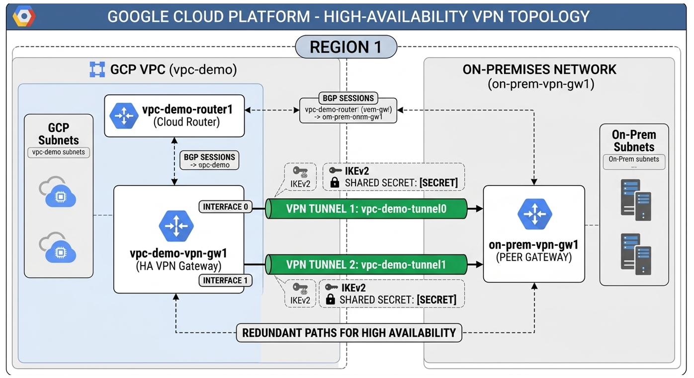
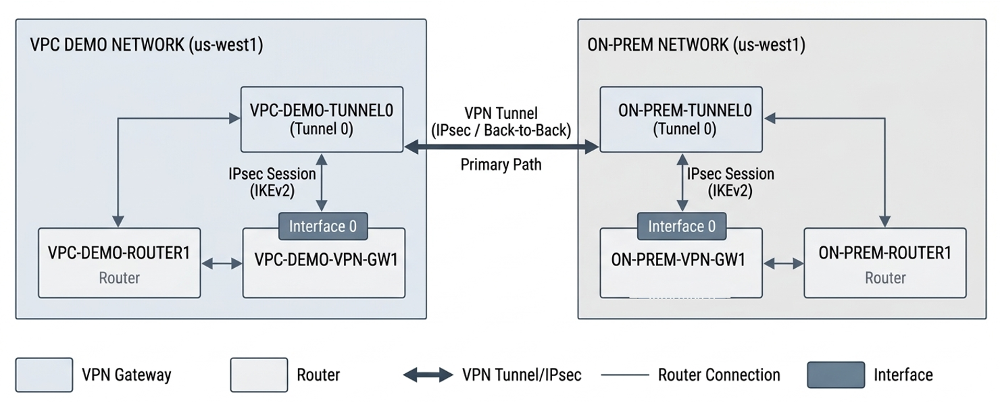
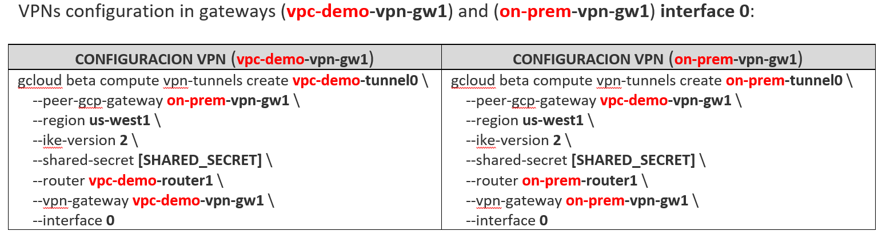
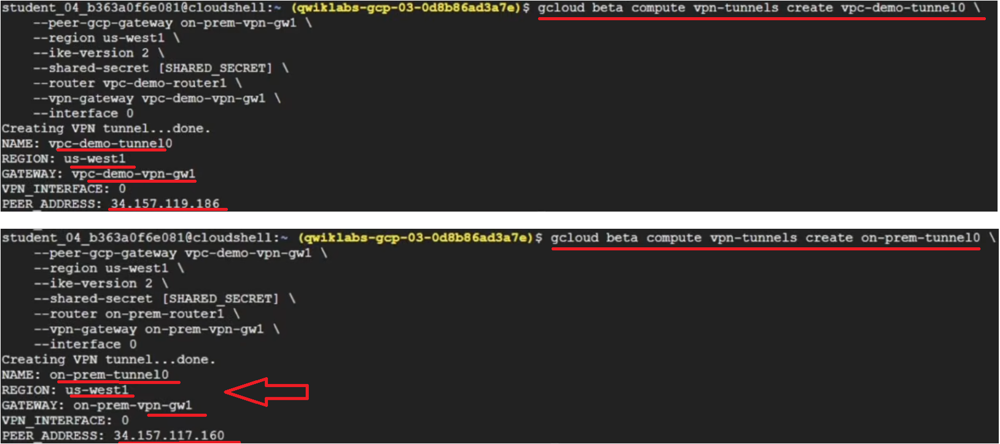
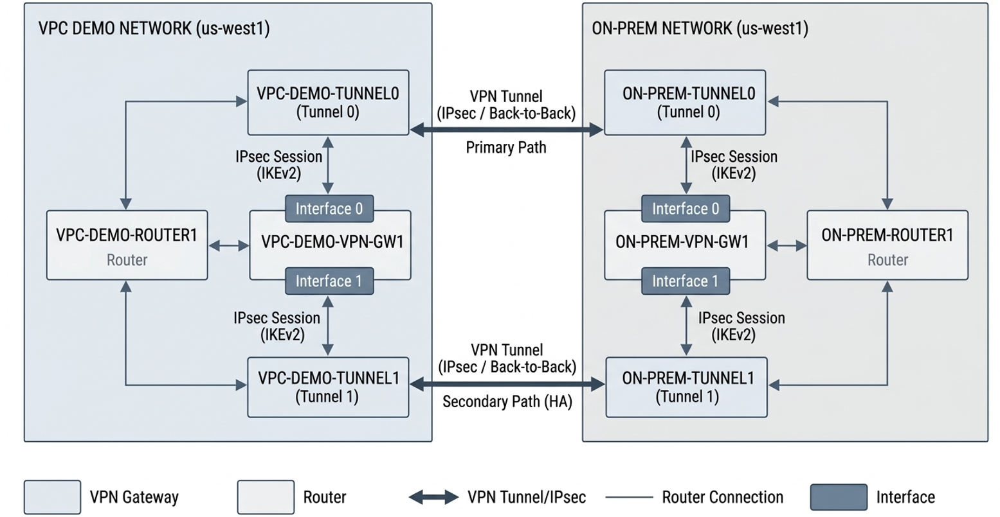
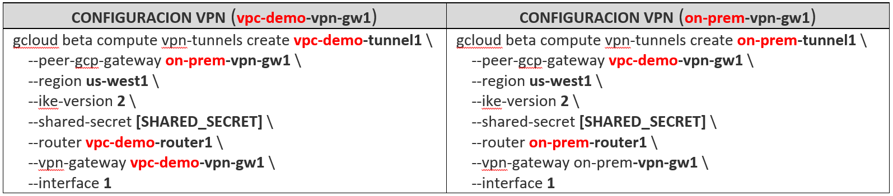

# TECHNICAL LOG & IMPLEMENTING CLOUD HA VPN IPSEC AND BGP PART 2/3

## GCP CLOUD HA GSP619
**CCNP Miguelangel Luna**

---

## CONTENT:

| Case | Title | Description |
| :--- | :--- | :--- |
| **01** | [Claude & n8n AI Agents](./case-01-Google-Auth/) | Agentes Claude . |


[Google Skills](https://www.skills.google/)

An end-to-end hands-on demonstration of configuring, testing, and optimizing high-availability hybrid connectivity using **Google Cloud HA VPN** and dynamic BGP routing between Google Cloud VPCs and simulated on-premises environments.

---

## Architecture Overview (Topology) 

This project simulates a hybrid enterprise environment connecting a production VPC in Google Cloud (`vpc-demo`) to a remote simulated data center (`on-prem`) via Cloud HA VPN over public internet infrastructure.

```
+----------------------------------------+              +----------------------------------------+
|               vpc-demo                 |              |                on-prem                 |
|            (Region: us-west1)          |              |           (Region: us-west1)           |
|                                        |              |                                        |
|  Subnet: 10.1.2.0/24                   |              |  Subnet: 192.168.1.0/24                |
|  Cloud Router: vpc-demo-router1        |              |  Cloud Router: on-prem-router1          |
|  ASN: 65001                            |              |  ASN: 65002                            |
|                                        |              |                                        |
|         [ HA VPN Gateway ]             |<============>|         [ HA VPN Gateway ]             |
|         - Tunnel 0 (BGP Session 0)     |  IPsec Tunnels - Tunnel 0 (BGP Session 0)     |
|         - Tunnel 1 (BGP Session 1)     |              |  - Tunnel 1 (BGP Session 1)     |
+----------------------------------------+              +----------------------------------------+
```



---

## Technical Specifications

| Parameter | VPC Environment (vpc-demo) | VPC Environment (on-prem) |
| :--- | :--- | :--- |
| **VPC Region** | `us-west1` | `us-west1` |
| **VPN Tunnel name Interface 0** | `vpc-demo-tunnel0` | `on-prem-tunnel0` |
| **VPN Tunnel name Interface 1** | `vpc-demo-tunnel1` | `on-prem-tunnel1` |
| **Ike version** | 2 | 2 |
| **Shared secret** | `[SHARED_SECRET]` | `[SHARED_SECRET]` |
| **Router Name** | `vpc-demo-router1` | `on-prem-router1` |
| **VPN Gateway Name** | `vpc-demo-vpn-gw1` | `on-prem-vpn-gw1` |
---

## Implementation Steps (Configuration)

### 1. Prerequisites & VPC Preparation

Ensure both VPN Gateways (vpc-demo-vpn-gw1) and (on-prem-vpn-gw) are created:

* **VPN GATEWAY (vpc-demo-vpn-gw1)**: VPN Gateway on premises in cloud GCP.
* **VPN GATEWAY (on-prem-vpn-gw)**: VPN Gateway on premises (simulated).


### 2. VPN Gateway (Configuration):





### 2.1) IPsec configuration on VPN gateway named (vpc-demo-vpn-gw1) on interface 0:

```bash
gcloud beta compute vpn-tunnels create vpc-demo-tunnel0 \
  --peer-gcp-gateway on-prem-vpn-gw1 \
  --region us-west1 \
  --ike-version 2 \
  --shared-secret [SHARED_SECRET] \
  --router vpc-demo-router1 \
  --vpn-gateway vpc-demo-vpn-gw1 \
  --interface 0
```

### 2.2) IPsec configuration on VPN gateway named (on-prem-vpn-gw1) on interface 0:


```bash
gcloud beta compute vpn-tunnels create on-prem-tunnel0 \
  --peer-gcp-gateway vpc-demo-vpn-gw1 \
  --region us-west1 \
  --ike-version 2 \
  --shared-secret [SHARED_SECRET] \
  --router on-prem-router1 \
  --vpn-gateway on-prem-vpn-gw1 \
  --interface 0
```
### IPSEC configuration command outputs on the Gateways



### 2.3) IPsec configuration on VPN gateway named (vpc-demo-vpn-gw1) on interface 1:

```bash
gcloud beta compute vpn-tunnels create vpc-demo-tunnel1 \
    --peer-gcp-gateway on-prem-vpn-gw1 \
    --region us-west1 \
    --ike-version 2 \
    --shared-secret [SHARED_SECRET] \
    --router vpc-demo-router1 \
    --vpn-gateway vpc-demo-vpn-gw1 \
    --interface 1
```
### 2.4) IPsec configuration on VPN gateway named (on-prem-vpn-gw1) on interface 1:

```bash
gcloud beta compute vpn-tunnels create on-prem-tunnel1 \
    --peer-gcp-gateway vpc-demo-vpn-gw1 \
    --region us-west1 \
    --ike-version 2 \
    --shared-secret [SHARED_SECRET] \
    --router on-prem-router1 \
    --vpn-gateway on-prem-vpn-gw1 \
    --interface 1
```





**Creating VPN Gateways (vpc-demo-vpn-gw1):**


## Key Features & Production Considerations
* **SLA Compliance**: Dual-tunnel layout achieves GCP's top 99.99% availability tier.
* **Dynamic Routing**: Uses BGP for automated path discovery, eliminating static routing risks.
* **Encrypted Transit**: All inter-site communication is encrypted end-to-end using IPsec.
