# TECHNICAL LOG & IMPLEMENTING CLOUD HA VPN IPSEC AND BGP PART 3/3

## GCP CLOUD HA GSP619
**CCNP Miguelangel Luna**







---

## CONTENIDOS:

| Case | Title | Description |
| :--- | :--- | :--- |
| **01** | [Claude & n8n AI Agents](./case-01-Google-Auth/) | Agentes Claude . |

[Google](https://www.google.com)

## 1. Introduction and Theoretical Framework

**pyATS =** The infrastructure for organizing, running, and reporting automated network tests in a professional way.

## 2. Topology and BGP Neighbor Establishment


## 3. IMPLEMENTATION:


**1.1) Create the working folder and enter it::**

```text
gcloud compute routers add-interface vpc-demo-router1 \
    --interface-name if-tunnel0-to-on-prem \
    --ip-address 169.254.0.1 \
    --mask-length 30 \
    --vpn-tunnel vpc-demo-tunnel0 \
    --region us-west1
```

```text
gcloud compute routers add-bgp-peer vpc-demo-router1 \
    --peer-name bgp-on-prem-tunnel0 \
    --interface if-tunnel0-to-on-prem \
    --peer-ip-address 169.254.0.2 \
    --peer-asn 65002 \
    --region us-west1
```


**Part 3:** Use the pyATS Testing Library

**3.1) Install pyATS**

Inside the virtual environment (make sure you see (csr1kv) in your terminal), run:

```text
pip3 install pyats[full]
```

**3.2) Verify the installation**

Verify that it was installed correctly by running:

```text
pyats --help
```

