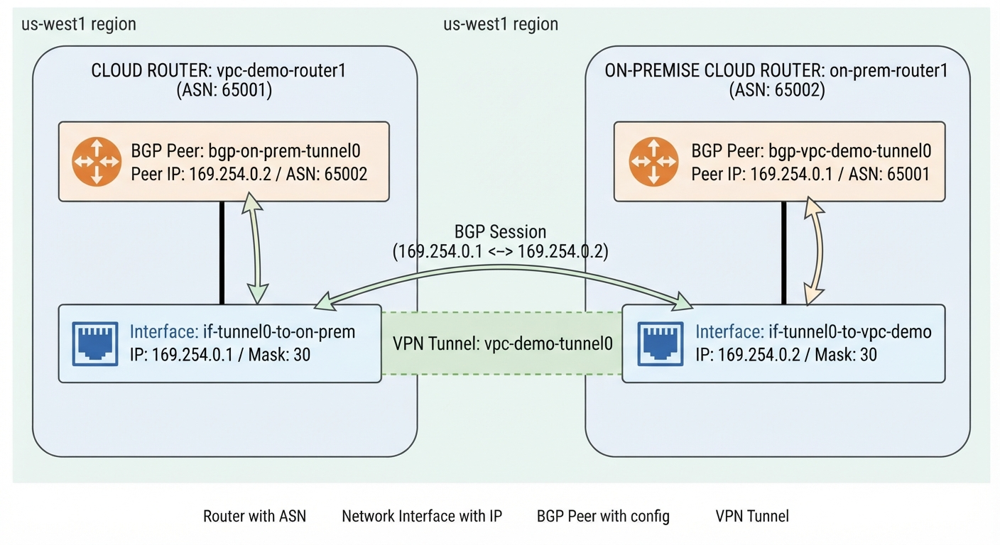
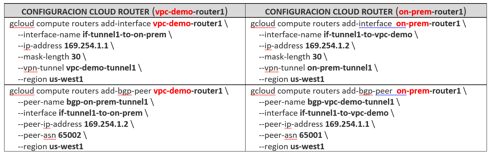

# TECHNICAL LOG & IMPLEMENTING CLOUD HA VPN IPSEC AND BGP PART 3/3

## GCP CLOUD HA GSP619
**CCNP Miguelangel Luna**


---

## CONTENT:

| Case | Title | Description |
| :--- | :--- | :--- |
| **01** | [Claude & n8n AI Agents](./case-01-Google-Auth/) | Agentes Claude . |

[Google](https://www.google.com)

## 1. Introduction and Theoretical Framework

**pyATS =**

## 2. Topology and BGP Neighbor Establishment


## 3. IMPLEMENTATION:


## ROUTER TUNNEL0 INTERFACE CONFIGURATION (vpc-demo-router1):

We have to create 2 tunnel interfaces per Cloud Router:

A) Interface tunnel0

B) Interface tunnel1



**TUNNEL0** INTERFACE CONFIGURATION OF THE ROUTER **(vpc-demo-router1)**:

**1.1)** Creation in CLOUD ROUTER **(vpc-demo-router1)** of the interface **(if-tunnel0-to-on-prem)** that will connect to the tunnel **(vpc-demo-tunnel0)**:

```text
gcloud compute routers add-interface vpc-demo-router1 \
    --interface-name if-tunnel0-to-on-prem \
    --ip-address 169.254.0.1 \
    --mask-length 30 \
    --vpn-tunnel vpc-demo-tunnel0 \
    --region us-west1
```

**1.2)** Configuration in CLOUD ROUTER **(vpc-demo-router1)** of the BGP peer **(169.254.0.2)** that will connect to the tunnel interface **(if-tunnel0-to-on-prem)** created in step **1.1**:

```text
gcloud compute routers add-bgp-peer vpc-demo-router1 \
    --peer-name bgp-on-prem-tunnel0 \
    --interface if-tunnel0-to-on-prem \
    --peer-ip-address 169.254.0.2 \
    --peer-asn 65002 \
    --region us-west1
```

## **TUNNEL0** INTERFACE CONFIGURATION OF THE ROUTER **(on-prem-router1)**:

**2.1)** Creation in CLOUD ROUTER **(on-prem-router1)** of the interface **(if-tunnel0-to-vpc-demo)** that will connect to the tunnel **(if-tunnel0-to-vpc-demo)**:

```text
gcloud compute routers add-interface on-prem-router1 \
    --interface-name if-tunnel0-to-vpc-demo \
    --ip-address 169.254.0.2 \
    --mask-length 30 \
    --vpn-tunnel on-prem-tunnel0 \
    --region us-west1
```

**2.2)** Configuration in CLOUD ROUTER **(on-prem-router1)** of the BGP peer **(169.254.0.1)** that will connect to the tunnel interface **(if-tunnel0-to-on-prem)** created in step **2.1**:

```text
gcloud compute routers add-bgp-peer on-prem-router1 \
    --peer-name bgp-vpc-demo-tunnel0 \
    --interface if-tunnel0-to-vpc-demo \
    --peer-ip-address 169.254.0.1 \
    --peer-asn 65001 \
    --region us-west1
```
We already have tunnel0 configured on both ends, as shown in the following image:




**TUNNEL1** INTERFACE CONFIGURATION OF THE ROUTER **(vpc-demo-router1)**:



**3.1)** Creation in CLOUD ROUTER **(vpc-demo-router1)** of the interface **(if-tunnel1-to-on-prem)** that will connect to the tunnel **(vpc-demo-tunnel1)**:

```text
gcloud compute routers add-interface vpc-demo-router1 \
    --interface-name if-tunnel1-to-on-prem \
    --ip-address 169.254.1.1 \
    --mask-length 30 \
    --vpn-tunnel vpc-demo-tunnel1 \
    --region us-west1
```
**3.2)** Configuration in CLOUD ROUTER **(vpc-demo-router1)** of the BGP peer **(169.254.1.2)** that will connect to the tunnel interface **(if-tunnel1-to-on-prem)** created in step **3.1**:

```text
gcloud compute routers add-bgp-peer vpc-demo-router1 \
    --peer-name bgp-on-prem-tunnel1 \
    --interface if-tunnel1-to-on-prem \
    --peer-ip-address 169.254.1.2 \
    --peer-asn 65002 \
    --region us-west1
```
