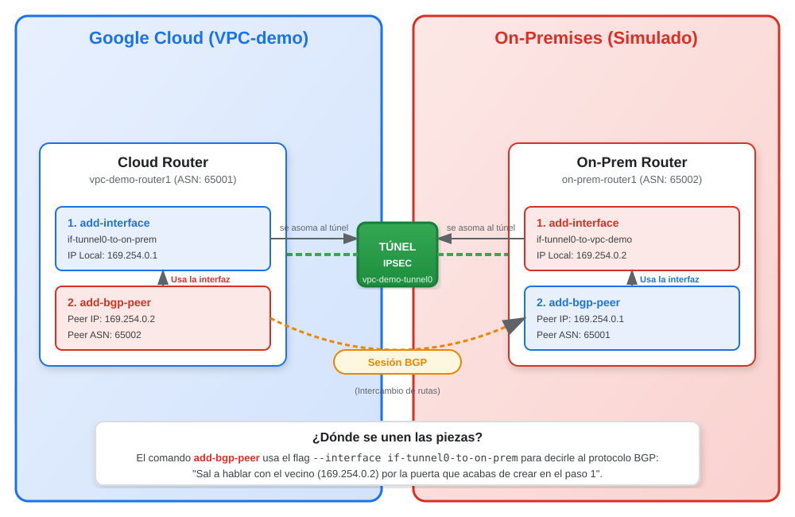
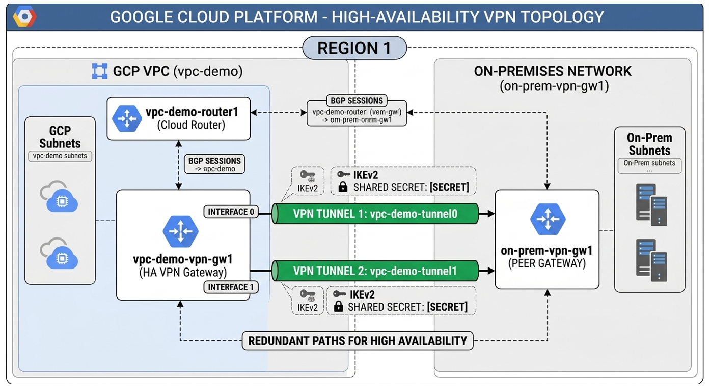
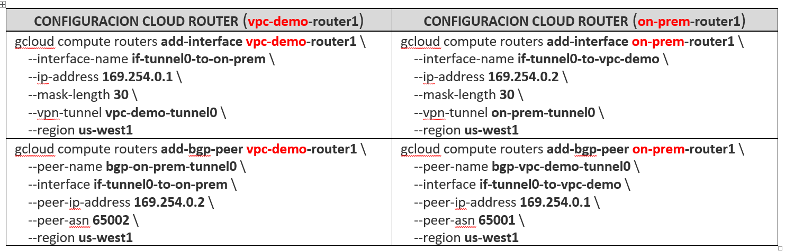

# TECHNICAL LOG & IMPLEMENTING CLOUD HA VPN IPSEC AND BGP PART 3/3

## GCP CLOUD HA GSP619
**CCNP Miguelangel Luna**




---

## CONTENIDOS:

| Case | Title | Description |
| :--- | :--- | :--- |
| **01** | [Claude & n8n AI Agents](./case-01-Google-Auth/) | Agentes Claude . |

[Google](https://www.google.com)

## 1. Introduction and Theoretical Framework

**pyATS =** The infrastructure for organizing, running, and reporting automated network tests in a professional way.

## 2. Topology and BGP Neighbor Establishment



## 3. IMPLEMENTATION:



Creacion de la interface **tunnel0** en el router **(vpc-demo-router1)** en el pvc network **(vpc-demo)**: 

Tenemos 2 VPC: 

A) **vpc-demo**: 

B) **on-prem-vpc**: 

Tenemos 2 Gateway VPN: 

A) **vpc-demo-vpn-gw1**: 

B) **on-prem-vpn-gw1**: 

Tenemos 2 Cloud Router: 

A) **vpc-demo-router1**: 

B) **on-prem-router1**: 

Tenemos 2 Interfaces por Gateway VPN: 

A) **vpc-demo-router1**: 

B) **on-prem-router1**: 

Tenemos que crear 2 interfaces tunnel por Cloud Router:

A) Interface tunnel0

B) Interface tunnel1

CONFIGURACION DE INTERFACES TUNNEL0 DEL ROUTER **(vpc-demo-router1)** :

**1.1)** Creacion en CLOUD ROUTER **(vpc-demo-router1)** de la interface **(if-tunnel0-to-on-prem)** que se conectara al tunel **(vpc-demo-tunnel0)**:

```text
gcloud compute routers add-interface vpc-demo-router1 \
    --interface-name if-tunnel0-to-on-prem \
    --ip-address 169.254.0.1 \
    --mask-length 30 \
    --vpn-tunnel vpc-demo-tunnel0 \
    --region us-west1
```

**1.2)** Configuracion en CLOUD ROUTER **(vpc-demo-router1)** del peer BGP **(169.254.0.2)** que se conectara a la interface tunel **(if-tunnel0-to-on-prem**) creada en el paso **1.1**:

```text
gcloud compute routers add-bgp-peer vpc-demo-router1 \
    --peer-name bgp-on-prem-tunnel0 \
    --interface if-tunnel0-to-on-prem \
    --peer-ip-address 169.254.0.2 \
    --peer-asn 65002 \
    --region us-west1
```
CONFIGURACION DE INTERFACES **TUNNEL0** DEL ROUTER **(on-prem-router1)**:

**2.1)** Creacion en CLOUD ROUTER **(on-prem-router1)** de la interface **(if-tunnel0-to-vpc-demo)** que se conectara al tunel **(if-tunnel0-to-vpc-demo)**:

```text
gcloud compute routers add-interface on-prem-router1 \
    --interface-name if-tunnel0-to-vpc-demo \
    --ip-address 169.254.0.2 \
    --mask-length 30 \
    --vpn-tunnel on-prem-tunnel0 \
    --region us-west1
```

**2.1)** Configuracion en CLOUD ROUTER **(on-prem-router1)** del peer BGP **(169.254.0.1)** que se conectara a la interface tunel **(if-tunnel0-to-on-prem**) creada en el paso **2.1**:

```text
gcloud compute routers add-bgp-peer on-prem-router1 \
    --peer-name bgp-vpc-demo-tunnel0 \
    --interface if-tunnel0-to-vpc-demo \
    --peer-ip-address 169.254.0.1 \
    --peer-asn 65001 \
    --region us-west1
```

**Part 3:** Use the pyATS Testing Library

**3.1) Install pyATS**

Inside the virtual environment (make sure you see (csr1kv) in your terminal), run:

```text
pip3 install pyats[full]
```

**3.2) Verify the installation**

Verify that it was installed correctly by running:

```text
pyats --help
```

