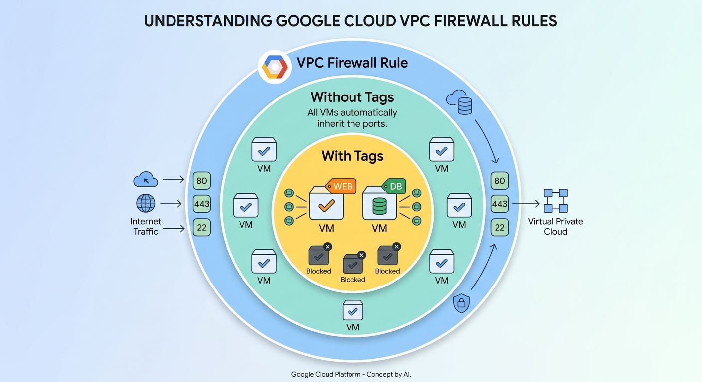
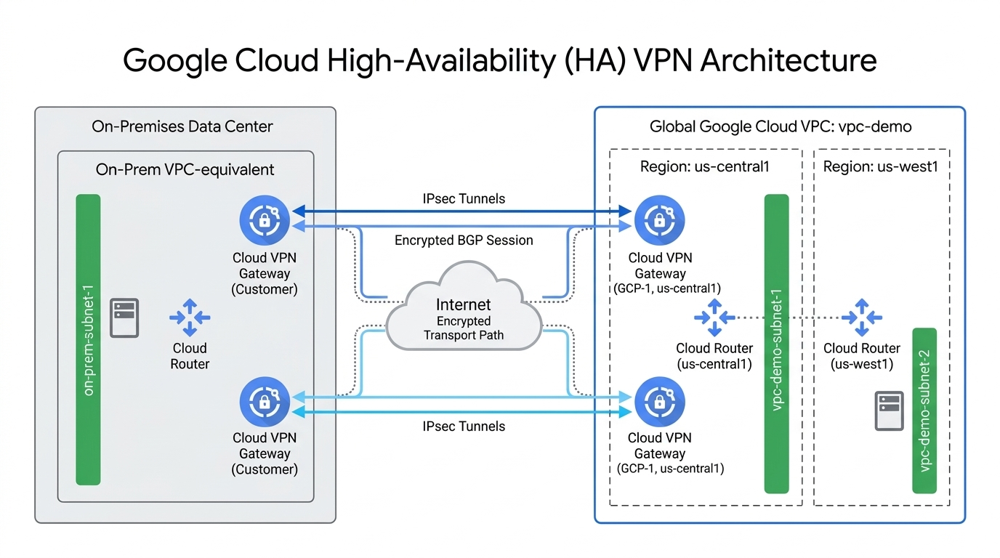

# TECHNICAL LOG & Enterprise Multi-Region Hybrid Network Architecture using Google Cloud HA-VPN & Dynamic BGP Routing

## Enterprise Multi-Region Hybrid Network Architecture using Google Cloud HA-VPN & Dynamic BGP Routing

**CCNP Miguelangel Luna**

---

## CONTENT:

| Case | Title | Description |
| :--- | :--- | :--- |
| **01** | [Claude & n8n AI Agents](./case-01-Google-Auth/) | Agentes Claude . |

[Google Cloud Platform](https://www.google.com)

## 1. Introduction and Theoretical Framework

**VPC:** is essentially your own **private IP address** space—an isolated virtual network environment—that has a global scope within your Google Cloud project. This allows any resource connected to it to communicate securely, **regardless of where in the world (region) that resource is physically located**.

Feactures:
- **Your own network block:** You decide which private IP ranges to use (for example, `10.0.0.0/16`) and how to divide them into subnets across different regions.
- **True global scope:** A VM in the `us-central1` (Iowa) region can communicate directly with a VM in `europe-west1` (Belgium) using their internal private IP addresses within the same VPC, **as if they were in the same building**.
- **Project-level scope:** By default, a **VPC belongs to a specific Google Cloud project** (although tools like Shared VPC exist if you need to share that same network with other projects in your organization).

**GCP firewall** is a virtual security guard that controls network traffic: it decides which connections are allowed to enter or leave your virtual machines and resources, blocking everything that is not explicitly authorized.

To understand how any firewall rule works (including the one in this example), GCP network architecture follows these core principles:

- **Default Deny (Ingress):**
  - **All incoming traffic (ingress) into a VPC is blocked by default**. No virtual machine can receive external or internal traffic unless an explicit rule allows it.
- **Default Allow (Egress):**
  - Conversely, **outgoing traffic (egress)** from instances to the outside world or to other internal resources **is allowed by default**, unless a restrictive egress rule is configured.
- **Priority Evaluation and Stateful Inspection:**
  - GCP firewall rules are **stateful**. This means that if incoming traffic is allowed, the corresponding response traffic going back out is automatically permitted without needing a separate return rule.

**IMPORTANT The "If it isn't allowed, it's blocked" principle:** If no rule in your **VPC specifies port 443**, it doesn't matter whether you try to communicate from the internet or from the VM next door—GCP's networking system will drop the packet.


 - **The firewall rule:** Opens the ports at the **VPC level**.
- **Without tags:** All VMs in the VPC inherit and apply these open ports automatically.
- **With tags:** You filter access so that only VMs with that specific tag will be able to receive that traffic; all other VMs in the same VPC remain blocked.


 

## 2. Topology and BGP Neighbor Establishment





##  Task 1. Cloud VPC setup

**1.1** From Cloud Shell, create a VPC network called **`vpc-demo`**:

- **`vpc-demo`**: User-defined name to be assigned to the new VPC network.

- - **`--subnet-mode custom`**: Defines the subnet creation mode for this VPC, By choosing `custom` (custom mode), subnets are not created automatically in every region. This gives full control to manually decide which IP ranges (CIDR blocks) to assign, in which regions to create them, and how to structure your network topology (essential for enterprise environments and high-availability architectures like HA-VPN).

```text
gcloud compute networks create vpc-demo --subnet-mode custom
```

## Task 2. Create subnets

- **`vpc-demo-subnet1`:** The name assigned to this specific new subnet (must be unique within that region and project).
- **`--network vpc-demo`:** Specifies the main VPC or parent network to which this subnet will belong (in this case, a network named **`vpc-demo`** that must already exist).
- **`--range 10.1.1.0/24`:** Defines the block of **private IP** addresses within this subnet. Here, you are reserving 256 IP addresses (ranging from `10.1.1.0` to `10.1.1.255`).
- **`--region "REGION 1"`:** Defines the geographical location (GCP region) where this subnet will be deployed (for example, `us-central1` or **`europe-west1`**, as subnets in GCP are regional).


**2.1** Now, create subnet **`vpc-demo-subnet1`** in the **`REGION 1`** region:

```text
gcloud beta compute networks subnets create vpc-demo-subnet1 \
--network vpc-demo --range 10.1.1.0/24 --region "REGION 1"
```
### Create subnets

**2.2** Create subnet **`vpc-demo-subnet2`** in the **`REGION 2`** region:

```text
gcloud beta compute networks subnets create vpc-demo-subnet2 \
--network vpc-demo --range 10.2.1.0/24 --region "REGION 2"
```

## Task 3. Create firewall rules for internal, SSH, and ICMP traffic:

**3.1**

- **`vpc-demo-allow-internal`**: The name assigned to this specific firewall rule (must be unique within the project).
- **`--network vpc-demo`:** Specifies the **target VPC network (**`vpc-demo`**) where this firewall rule will be enforced**.
- **`--allow tcp:0-65535,udp:0-65535,icmp`:** Defines what traffic is permitted by this rule:
  - **`tcp:0-65535`:** Allows all TCP ports from port 0 to 65535 (full TCP traffic).
  - **`udp:0-65535`:** Allows all UDP ports from 0 to 65535 (full UDP traffic).
  - **`icmp`:** Allows Internet Control Message Protocol traffic (used for tools like `ping`).
  - **Note:** Combined, this rule allows virtually all types of network traffic.
- **`--source-ranges 10.0.0.0/8`:** Defines where the traffic must come from for this rule to apply. In this case, it applies only to traffic originating from any IP address inside the `10.0.0.0/8` private network range (a very common internal corporate/cloud range).

```text
gcloud compute firewall-rules create vpc-demo-allow-internal \
  --network vpc-demo --allow tcp:0-65535,udp:0-65535,icmp --source-ranges 10.0.0.0/8
```

```text
gcloud compute firewall-rules create vpc-demo-allow-ssh-icmp \
  --network vpc-demo --allow tcp:22,icmp
```

## Task 4: Create Test Virtual Machine Instances:

**4.1**instances create: The combined action to create a new virtual machine (VM) instance.

**vpc-demo-instance1:** The name you are assigning to this specific virtual machine (must be unique within the zone and project).

**--zone "ZONE 2":** Defines the specific zone (e.g., us-central1-a) where the virtual machine will be physically hosted. (Remember that subnets are regional, but instances live inside a specific zone within that region).

**--subnet vpc-demo-subnet1:** Specifies the subnetwork to which this VM's primary network interface will be connected, tying it directly to your VPC and its IP addressing scheme.

**--machine-type e2-medium:** Defines the hardware configuration (CPU and RAM) for the VM. An e2-medium provides a balanced configuration (typically 2 vCPUs and 4 GB of memory) ideal for general-purpose workloads.

```text
gcloud compute instances create vpc-demo-instance1 --zone "ZONE 2" --subnet vpc-demo-subnet1 --machine-type e2-medium
```

```text
gcloud compute instances create vpc-demo-instance2 --zone "ZONE" --subnet vpc-demo-subnet2 --machine-type e2-medium
```

## Task 5: On-Premises Local Environment Simulation

**5.1** **Create the on-prem VPC network:**

```text
gcloud compute networks create on-prem --subnet-mode custom
```

**5.2** **Create the local subnet:**

```text
gcloud beta compute networks subnets create on-prem-subnet1 \
  --network on-prem --range 192.168.1.0/24 --region "REGION 1"
```

**5.3** **Create firewall rules for the local network:**

```text
gcloud compute firewall-rules create on-prem-allow-internal \
  --network on-prem --allow tcp:0-65535,udp:0-65535,icmp --source-ranges 192.168.0.0/16
```
```text
gcloud compute firewall-rules create on-prem-allow-ssh-icmp \
  --network on-prem --allow tcp:22,icmp
```

**5.3 Create the local test instance:**

```text
gcloud compute instances create on-prem-instance1 --zone "ZONE 1" --subnet on-prem-subnet1 --machine-type e2-medium
```

## Task 6: Configuring HA-VPN and Tunnels:

**6.1 Create the HA-VPN gateways in both networks:**

- **`vpn-gateways create`:** The specific action to create a **Cloud VPN gateway** (specifically, a Highly Available / HA-VPN gateway).
- **`vpc-demo-vpn-gw1`:** The name assigned to this **VPN gateway** resource.
- **`--network vpc-demo`:** Specifies the **Virtual Private Cloud (VPC)** network where this VPN gateway will be deployed, connecting your VPN tunnels to this network's infrastructure.
- **`--region "REGION 1"`:** Defines the geographic region (e.g., `us-central1`) where the VPN gateway will be provisioned. (Unlike global VPCs, HA-VPN gateways are regional resources).

```text
gcloud beta compute vpn-gateways create vpc-demo-vpn-gw1 \
  --network vpc-demo \
  --region "REGION 1"
```

```text
gcloud beta compute vpn-gateways create on-prem-vpn-gw1 \
  --network on-prem \
  --region "REGION 1"
```

**6.2 Create the Cloud Routers for dynamic BGP routing**

**network: vpc-demo**
**ASN**: 65001

**network: on-prem**
**ASN:** 65002

```text
gcloud compute routers create vpc-demo-router1 \
  --region "REGION 1" \
  --network vpc-demo \
  --asn 65001
```

```text
gcloud compute routers create on-prem-router1 \
  --region "REGION 1" \
  --network on-prem \
  --asn 65002
```

## Task 7: Configuring HA-VPN and Tunnels:

**7.1 Create the VPN tunnels (two tunnels per gateway to ensure the 99.99% SLA):**


#7.1.1 Túneles desde vpc-demo hacia on-prem
```text
gcloud beta compute vpn-tunnels create vpc-demo-tunnel0 --peer-gcp-gateway on-prem-vpn-gw1 --region "REGION 1" --ike-version 2 --shared-secret [SHARED SECRET] --router vpc-demo-router1 --vpn-gateway vpc-demo-vpn-gw1 --interface 0
```

```text
gcloud beta compute vpn-tunnels create vpc-demo-tunnel1 --peer-gcp-gateway on-prem-vpn-gw1 --region "REGION 1" --ike-version 2 --shared-secret [SHARED SECRET] --router vpc-demo-router1 --vpn-gateway vpc-demo-vpn-gw1 --interface 1
```

#7.1.2  Túneles desde on-prem hacia vpc-demo

- **`vpn-tunnels create`**: The specific action to create a new VPN tunnel that securely connects your VPN gateway to a peer gateway.
- **`vpc-demo-tunnel0`**: The name assigned to this specific VPN tunnel.
- **`--peer-gcp-gateway on-prem-vpn-gw1`**: Specifies the peer VPN gateway to which this tunnel connects (in this context, representing the remote or on-premises gateway configuration).
- **`--region "REGION 1"`**: Defines the geographic region where the VPN tunnel resource is deployed (must match the region of your VPN gateway).
- **`--ike-version 2`**: Sets the Internet Key Exchange (IKE) protocol version to version 2, which is standard for establishing security associations and negotiating encryption parameters.
- **`--shared-secret [SHARED SECRET]`**: Provides the pre-shared authentication key (PSK) that must match on both sides of the VPN tunnel to authenticate the connection.
- **`--router vpc-demo-router1`**: Associates this tunnel with a Cloud Router, which dynamically exchanges routes between your VPC and the peer network using BGP (Border Gateway Protocol).
- **`--vpn-gateway vpc-demo-vpn-gw1`**: Specifies the local Cloud VPN gateway (created in the previous command) that terminates one end of this tunnel.
- **`--interface 0`**: Specifies which interface number (e.g., interface 0) on your local HA-VPN gateway this tunnel is bound to. (HA-VPN gateways use two interfaces, `0` and `1`, for redundancy).

```text
gcloud beta compute vpn-tunnels create on-prem-tunnel0 --peer-gcp-gateway vpc-demo-vpn-gw1 --region "REGION 1" --ike-version 2 --shared-secret [SHARED SECRET] --router on-prem-router1 --vpn-gateway on-prem-vpn-gw1 --interface 0
```

```text
gcloud beta compute vpn-tunnels create on-prem-tunnel1 --peer-gcp-gateway vpc-demo-vpn-gw1 --region "REGION 1" --ike-version 2 --shared-secret [SHARED SECRET] --router on-prem-router1 --vpn-gateway on-prem-vpn-gw1 --interface 1
```

## Task 8: Configure BGP peering for both routers and interfaces: (Configure the link interfaces with link-local IP addresses `169.254.0.x` and `169.254.1.x`, assigning the corresponding ASNs).

```text
gcloud compute firewall-rules create vpc-demo-allow-subnets-from-on-prem \
  --network vpc-demo \
  --allow tcp,udp,icmp \
  --source-ranges 192.168.1.0/24
```

```text
gcloud compute firewall-rules create on-prem-allow-subnets-from-vpc-demo \
  --network on-prem \
  --allow tcp,udp,icmp \
  --source-ranges 10.1.1.0/24,10.2.1.0/24
```

## Task 9: Global Routing and High Availability

- Since HA-VPN is a regional resource, to reach instances in regions other than that of the Cloud Router, you must enable global routing mode:
  
```text
gcloud compute networks update vpc-demo-bgp-routing-mode GLOBAL
```
